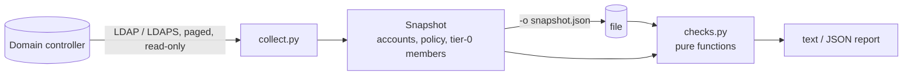

# ad-doctor

Read-only Active Directory health and misconfiguration audit over LDAP.

ad-doctor binds as an ordinary domain user, takes one snapshot of the domain and runs
checks for the misconfigurations attackers look for first: roastable accounts, risky
delegation, weak policy, unprotected admins. It writes nothing to the directory.

Against the seeded lab domain (`lab/`):

```text
$ ad-doctor scan 127.0.0.1 --ldaps --port 10636 -u 'ADLAB\adreader'
ad-doctor 0.1.0  domain adlab.test  17 accounts  2026-11-04 22:41 UTC

[HIGH  ] AD-ACC-002  Reversible password encryption
         Passwords for these accounts are stored in a form equivalent to plain text.
         objects: old_vpn
         fix: Clear 'Store password using reversible encryption' and reset the passwords.

[HIGH  ] AD-ACC-004  Guest account enabled
         The built-in Guest account allows unauthenticated-style access to the domain.
         objects: Guest
         fix: Disable the Guest account.

[HIGH  ] AD-DEL-001  Unconstrained delegation outside domain controllers
         These hosts keep the TGT of every user who authenticates to them; coercing a DC to connect yields domain compromise.
         objects: APP01$
         fix: Switch to constrained or resource-based delegation, or remove delegation.

[HIGH  ] AD-KRB-002  Accounts without Kerberos pre-authentication (AS-REP roasting)
         Anyone can request an AS-REP for these accounts and crack the password offline.
         objects: legacy_app
         fix: Clear 'Do not require Kerberos preauthentication' on each account.

...

summary: high 5  medium 8  low 1  info 0
```

## Checks

| ID | Finding | Severity |
|---|---|---|
| AD-KRB-001 | krbtgt password older than 180 days | high |
| AD-KRB-002 | Accounts without Kerberos pre-authentication (AS-REP roasting) | high |
| AD-KRB-003 | User accounts with SPNs (Kerberoasting); high when privileged | medium/high |
| AD-KRB-004 | Accounts limited to DES | medium |
| AD-DEL-001 | Unconstrained delegation outside domain controllers | high |
| AD-DEL-002 | Constrained delegation with protocol transition | medium |
| AD-DEL-003 | Resource-based constrained delegation configured | low |
| AD-ACC-001 | Enabled accounts allowed an empty password (`PASSWD_NOTREQD`) | medium |
| AD-ACC-002 | Reversible password encryption | high |
| AD-ACC-003 | Privileged accounts whose password never expires | medium |
| AD-ACC-004 | Guest account enabled | high |
| AD-ACC-005 | Enabled users inactive for 90+ days | low |
| AD-PRIV-001 | Tier-0 groups with more than 5 members | low |
| AD-PRIV-002 | Privileged accounts that can be delegated | medium |
| AD-POL-001 | Weak default password policy | medium |
| AD-POL-002 | `ms-DS-MachineAccountQuota` above 0 | medium |
| AD-SEC-001 | Computers without LAPS | medium |

## Usage

```bash
uv tool install git+https://github.com/brkozer/ad-doctor

# collect and analyze in one go (password from AD_DOCTOR_PASSWORD or a prompt)
ad-doctor scan dc01.corp.example --ldaps -u 'CORP\auditor'

# or collect once, analyze offline later
ad-doctor collect dc01.corp.example --ldaps -u 'CORP\auditor' -o snapshot.json
ad-doctor analyze snapshot.json -f json --fail-on high
```

`--fail-on` makes the exit code 2 when a finding at that severity or above exists, so a
scheduled job can alert on regressions. `ad-doctor checks` lists the check IDs and
`--only` runs a subset.

Domain controllers that require LDAP signing (the default on Windows Server 2025) reject
plain LDAP binds; use `--ldaps`.

## How it works



The collector makes a fixed number of searches regardless of domain size: the domain
object, all users, all computers, and the transitive members of each tier-0 group
(Domain/Enterprise/Schema Admins, Administrators and the built-in operator groups,
matched by SID so localized domains work). Checks never touch the network, which keeps
them fast and lets the unit tests run without a domain controller.

## Development

```bash
uv sync
uv run ruff check . && uv run mypy && uv run pytest
```

`lab/` builds a disposable Windows Server 2025 evaluation DC under KVM and seeds it with
one instance of each misconfiguration; `tests/test_lab.py` asserts that every one is
found and that the clean control account is not:

```bash
AD_DOCTOR_LAB_HOST=127.0.0.1 AD_DOCTOR_LAB_PORT=10636 AD_DOCTOR_LAB_USER='ADLAB\adreader' \
AD_DOCTOR_PASSWORD=... uv run pytest -m lab
```

## License

MIT
