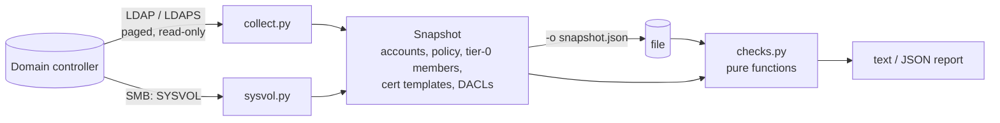

# ad-doctor

[](https://github.com/brkozer/ad-doctor/actions/workflows/ci.yml)
[](LICENSE)

Read-only Active Directory misconfiguration audit.

ad-doctor binds as an ordinary domain user, takes one snapshot of the domain over LDAP
(plus SYSVOL over SMB) and runs 25 checks for the things attackers look for first:
roastable accounts, risky delegation, exploitable certificate templates, DCSync and other
dangerous ACLs, passwords left in Group Policy. It writes nothing to the directory.

<p align="center"></p>

The screenshot is a real scan of the lab domain in [`lab/`](lab), a Windows Server 2025
DC seeded with one instance of every misconfiguration.

## Checks

| ID | Finding | Severity |
|---|---|---|
| AD-KRB-001 | krbtgt password older than 180 days | high |
| AD-KRB-002 | Accounts without Kerberos pre-authentication (AS-REP roasting) | high |
| AD-KRB-003 | User accounts with SPNs (Kerberoasting); high when privileged | medium/high |
| AD-KRB-004 | Accounts limited to DES | medium |
| AD-DEL-001 | Unconstrained delegation outside domain controllers | high |
| AD-DEL-002 | Constrained delegation with protocol transition | medium |
| AD-DEL-003 | Resource-based constrained delegation configured | low |
| AD-ACC-001 | Enabled accounts allowed an empty password (`PASSWD_NOTREQD`) | medium |
| AD-ACC-002 | Reversible password encryption | high |
| AD-ACC-003 | Privileged accounts whose password never expires | medium |
| AD-ACC-004 | Guest account enabled | high |
| AD-ACC-005 | Enabled users inactive for 90+ days | low |
| AD-PRIV-001 | Tier-0 groups with more than 5 members | low |
| AD-PRIV-002 | Privileged accounts that can be delegated | medium |
| AD-POL-001 | Weak default password policy | medium |
| AD-POL-002 | `ms-DS-MachineAccountQuota` above 0 | medium |
| AD-SEC-001 | Computers without LAPS | medium |
| AD-ADCS-001 | ESC1: enrollee-supplied subject on an authentication template | high |
| AD-ADCS-002 | ESC2: any-purpose or no-EKU template | high |
| AD-ADCS-003 | ESC3: enrollment agent template open to broad groups | high |
| AD-ADCS-004 | ESC4: broad groups can modify a certificate template | high |
| AD-ACL-001 | Non-default principals with DCSync rights | high |
| AD-ACL-002 | Non-default control over AdminSDHolder | high |
| AD-ACL-003 | Non-default control over the domain object | high |
| AD-GPP-001 | Passwords in Group Policy Preferences (MS14-025) | high |

ESC1–3 fire only for templates that are published on an enterprise CA, issue without
manager approval or authorized signatures, and can be enrolled in by broad groups
(Domain Users, Domain Computers, Authenticated Users, Everyone). "Non-default" in the ACL
checks means anyone outside tier 0 (Domain/Enterprise/Schema Admins, Administrators,
domain controllers, SYSTEM).

## Usage

```bash
uv tool install git+https://github.com/brkozer/ad-doctor

# collect and analyze in one go (password from AD_DOCTOR_PASSWORD or a prompt)
ad-doctor scan dc01.corp.example --ldaps -u 'CORP\auditor'

# or collect once, analyze offline later
ad-doctor collect dc01.corp.example --ldaps -u 'CORP\auditor' -o snapshot.json
ad-doctor analyze snapshot.json -f json --fail-on high
```

`--fail-on` makes the exit code 2 when a finding at that severity or above exists, so a
scheduled job can alert on regressions. `ad-doctor checks` lists the check IDs and
`--only` runs a subset. `--no-sysvol` skips the SMB part; parts that cannot run (no AD CS,
SYSVOL unreachable) are reported as notes instead of failing the scan.

Domain controllers that require LDAP signing (the default on Windows Server 2025) reject
plain LDAP binds; use `--ldaps`.

## How it works



The collector reads the domain object, all users and computers, the transitive members
of each tier-0 group (matched by SID, so localized domains work), the certificate
templates and enrollment services, and the DACLs of the domain object, AdminSDHolder and
every template. Security descriptors are requested with the SD flags control for the
DACL only, which ordinary users are allowed to read, and parsed by a small built-in
parser (`sd.py`). From SYSVOL it keeps only file paths and account names, never the
`cpassword` values.

Checks never touch the network, which keeps them fast and lets the unit tests run
without a domain controller.

## Development

```bash
uv sync
uv run ruff check . && uv run mypy && uv run pytest
```

`lab/` builds a disposable Windows Server 2025 evaluation DC under KVM (QEMU user
networking with ports forwarded to localhost only) and seeds it with one instance of
each misconfiguration; `tests/test_lab.py` asserts that every one is found and that the
clean control account and the built-in templates are not:

```bash
AD_DOCTOR_LAB_HOST=127.0.0.1 AD_DOCTOR_LAB_PORT=10636 AD_DOCTOR_LAB_SMB_PORT=10445 \
AD_DOCTOR_LAB_USER='ADLAB\adreader' AD_DOCTOR_PASSWORD=... uv run pytest -m lab

uv run python scripts/demo_svg.py docs/demo.svg   # regenerate the screenshot
```

## License

MIT
