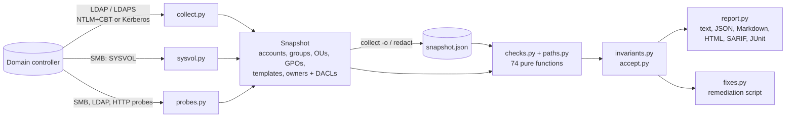

# ad-doctor

[](https://github.com/brkozer/ad-doctor/actions/workflows/ci.yml)
[](LICENSE)

Read-only Active Directory security audit that fits in a pipeline.

ad-doctor binds as an ordinary domain user, takes one snapshot of the domain over LDAP
(plus SYSVOL and a few cheap probes over SMB and HTTP) and runs 74 checks for what
attackers look for first: roastable accounts, risky delegation, exploitable certificate
templates (ESC1–5, 8, 9, 13–15), DCSync and other takeover rights, shadow credentials,
BadSuccessor, editable GPOs on domain controllers, passwords in Group Policy and scripts,
relay-friendly settings, weak trusts and legacy configuration. It then finds every
control path from a non-admin to tier 0. It writes nothing to the directory.

<p align="center"></p>

The screenshots are real scans of the lab domain in [`lab/`](lab): a Windows Server 2025
DC seeded with one instance of every misconfiguration that a single domain can hold.

## What sets it apart

- **Attack paths without a graph database.** `AD-PATH-001` builds the control graph
  (group membership, takeover ACEs, ownership, DCSync, GPO links, exploitable templates,
  gMSA readers) from the snapshot and reports the shortest path from every non-tier-0
  principal to tier 0, plus the share of users that have one. `ad-doctor blast-radius`
  answers "what does this account control if it is phished?".
- **Compound findings.** `AD-CHAIN-*` raise the alarm when individually medium findings
  add up to a known one-step compromise (relay to RBCD, coercion plus unconstrained
  delegation, coercion plus ESC8).
- **Built for CI and change management.** SARIF 2.1.0 (validated against the schema),
  JUnit, JSON with stable per-finding fingerprints, exit codes with `--fail-on`, and
  `--baseline` / `diff` so a scheduled job fails only on *new* findings.
- **Policy as code.** An `invariants.toml` declares the expected state (exact tier-0
  membership, allowed DCSync principals, published templates, required settings); any
  drift becomes a finding.
- **Accepted risks with owners and expiry.** Expired acceptances turn back into findings,
  acceptances that no longer match anything are reported as stale, and the ones expiring
  within 30 days are listed.
- **A fix script you can review.** `--fixes fix.ps1` writes the PowerShell for each
  finding with `-WhatIf` on every change (commented out where there is no dry-run), so it
  is safe to run as-is.
- **Shareable snapshots.** `ad-doctor redact` pseudonymizes names, DNs, hosts and the
  domain SID with a keyed HMAC, so a snapshot can go to a consultant or a bug report and
  still produce the same findings.
- **Runs from any Linux box** with an ordinary account: no domain-joined host, no RSAT,
  no admin rights. NTLM with channel binding (works where the DC enforces it) or Kerberos
  from a ticket cache.

Tools like PingCastle and Purple Knight cover more ground overall and Locksmith goes
deeper into AD CS; ad-doctor is the scriptable option, and the one that tests itself
against a live DC.

<p align="center"></p>

## Checks

| Area | ID | Finding | Severity |
|---|---|---|---|
| Kerberos | AD-KRB-001 | krbtgt password older than 180 days | high |
| | AD-KRB-002 | Accounts without Kerberos pre-authentication (AS-REP roasting) | high |
| | AD-KRB-003 | User accounts with SPNs (Kerberoasting); high when privileged | medium/high |
| | AD-KRB-004 | Accounts limited to DES | medium |
| | AD-KRB-005 | Service accounts without AES keys (RC4 only) | medium |
| | AD-KRB-006 | Seamless SSO (`AZUREADSSOACC$`) key not rolled over in 30 days | medium |
| Delegation | AD-DEL-001 | Unconstrained delegation outside domain controllers | high |
| | AD-DEL-002 | Constrained delegation with protocol transition | medium |
| | AD-DEL-003 | Resource-based constrained delegation configured | low |
| | AD-DEL-004 | Delegation to DC services or krbtgt, RBCD on DCs | high |
| Accounts | AD-ACC-001 | Enabled accounts allowed an empty password (`PASSWD_NOTREQD`) | medium |
| | AD-ACC-002 | Reversible password encryption | high |
| | AD-ACC-003 | Privileged accounts whose password never expires | medium |
| | AD-ACC-004 | Guest account enabled | high |
| | AD-ACC-005 | Enabled users inactive for 90+ days | low |
| | AD-ACC-006 | `adminCount` left on accounts that are no longer privileged | low |
| | AD-ACC-007 | SID history; high for privileged or same-domain SIDs | medium/high |
| | AD-ACC-008 | Passwords in `description` or `info` (text never reproduced) | medium |
| | AD-ACC-009 | Readable `userPassword` / `unixUserPassword` / `msSFU30Password` | high |
| | AD-ACC-010 | Pre-created computers whose password is their name | high |
| | AD-ACC-011 | Privileged passwords older than a year | medium |
| Privileged access | AD-PRIV-001 | Tier-0 groups with more than 5 members | low |
| | AD-PRIV-002 | Privileged accounts that can be delegated | medium |
| | AD-PRIV-003 | Schema Admins or Enterprise Admins not empty | low |
| | AD-PRIV-004 | Members of DnsAdmins | medium |
| | AD-PRIV-005 | Anonymous or Everyone in Pre-Windows 2000 Compatible Access | medium |
| | AD-PRIV-006 | Disabled, computer or foreign accounts in tier-0 groups | medium |
| | AD-PRIV-007 | Membership hidden through `primaryGroupID` | high |
| | AD-PRIV-008 | Operator groups not empty | medium |
| | AD-PRIV-009 | Cert Publishers members that are not CA servers | medium |
| | AD-PRIV-010 | Protected Users not used for administrators | info |
| Policy | AD-POL-001 | Weak default password policy | medium |
| | AD-POL-002 | `ms-DS-MachineAccountQuota` above 0 | medium |
| Hardening | AD-SEC-001 | Windows computers without LAPS | medium |
| | AD-SEC-002 | LAPS passwords readable by the scanning account | high |
| Infrastructure | AD-INF-001 | Computers on unsupported Windows versions; high for DCs | medium/high |
| | AD-INF-002 | AD Recycle Bin disabled | low |
| | AD-INF-003 | Domain functional level below Windows Server 2016 | low |
| | AD-INF-004 | Unsafe `dsHeuristics` (anonymous LDAP, AdminSDHolder exclusions) | medium/high |
| | AD-INF-005 | LDAP signing not required (probe) | medium |
| | AD-INF-006 | Trusts without SID filtering or with TGT delegation | high |
| | AD-INF-007 | BadSuccessor: dMSA creation rights outside tier 0 (2025 domains) | high |
| | AD-INF-008 | SMB signing not required on the DC (probe) | high |
| | AD-INF-009 | Print Spooler running on the DC (probe); high with unconstrained delegation | medium/high |
| | AD-INF-010 | LDAPS channel binding not enforced (probe) | medium |
| | AD-INF-011 | No backup of the domain partition in 7 days | medium |
| | AD-INF-012 | RODCs that may cache privileged credentials | medium |
| Certificate services | AD-ADCS-001 | ESC1: enrollee-supplied subject on an authentication template | high |
| | AD-ADCS-002 | ESC2: any-purpose or no-EKU template | high |
| | AD-ADCS-003 | ESC3: enrollment agent template open to broad groups | high |
| | AD-ADCS-004 | ESC4: broad groups can modify a certificate template | high |
| | AD-ADCS-005 | ESC5: non-tier-0 control over CA objects, templates or NTAuth | high |
| | AD-ADCS-006 | ESC9: authentication template without the security extension | medium |
| | AD-ADCS-007 | ESC13: issuance policy linked to a group | high |
| | AD-ADCS-008 | ESC15: schema v1 template with enrollee-supplied subject | high |
| | AD-ADCS-009 | ESC14: weak explicit certificate mappings | medium/high |
| | AD-ADCS-010 | ESC8: web enrollment accepts NTLM over HTTP (probe) | high |
| | AD-ADCS-011 | Published templates allowing RSA keys under 2048 bits | medium |
| Permissions | AD-ACL-001 | Non-default principals with DCSync rights | high |
| | AD-ACL-002 | Non-default control over AdminSDHolder | high |
| | AD-ACL-003 | Non-default control over the domain object | high |
| | AD-ACL-004 | Takeover rights or ownership on tier-0 accounts, groups and DCs (shadow credentials, RBCD, members, password reset, SPN) | high |
| | AD-ACL-005 | AdminSDHolder inherits permissions | high |
| | AD-ACL-006 | gMSA passwords readable outside tier 0 | medium/high |
| Group Policy | AD-GPO-001 | GPOs linked to the domain or DC OU editable outside tier 0 | high |
| | AD-GPO-002 | Non-tier-0 principals can link GPOs to the domain or DCs | high |
| | AD-GPO-003 | NTLMv1/LM, LM hashes, reversible encryption or dangerous privileges in those GPOs | medium/high |
| | AD-GPO-004 | Other GPOs editable outside tier 0 | medium |
| | AD-GPP-001 | Passwords in Group Policy Preferences (MS14-025) | high |
| | AD-GPP-002 | Credentials in SYSVOL or NETLOGON scripts (values never reproduced) | high |
| Attack paths | AD-PATH-001 | Control paths from non-tier-0 principals to tier 0 | high |
| | AD-CHAIN-001 | Relay to RBCD (signing or channel binding off, plus machine account quota) | high |
| | AD-CHAIN-002 | Coercion plus unconstrained delegation | high |
| | AD-CHAIN-003 | Coercion plus web enrollment relay (ESC8) | high |

Template checks fire only for templates published on an enterprise CA that issue without
manager approval or authorized signatures and that broad groups (Domain Users, Domain
Computers, Authenticated Users, Everyone) can enroll in. "Tier 0" means
Domain/Enterprise/Schema Admins, Administrators, the operator groups, domain controllers,
SYSTEM and the built-in Administrator; well-known delegations (SELF, Key Admins on
`msDS-KeyCredentialLink`, Cert Publishers and the CA server on PKI objects) are not
reported. Every finding carries its MITRE ATT&CK techniques (`ad-doctor checks -f json`).

The risk score adds 15 per high, 6 per medium and 2 per low finding, capped at 100;
grades run from A (10 or less) to F (above 70). It is meant for tracking one domain over
time, not for comparing domains.

## Usage

```bash
uv tool install git+https://github.com/brkozer/ad-doctor          # or: ... ad-doctor[kerberos]

# scan (password from AD_DOCTOR_PASSWORD or a prompt)
ad-doctor scan dc01.corp.example --ldaps -u 'CORP\auditor'

# HTML report and a reviewable remediation script
ad-doctor scan dc01.corp.example --ldaps -u 'CORP\auditor' -f html -o report.html --fixes fix.ps1

# Kerberos from the current ticket cache (kinit first; use the DC's host name)
ad-doctor scan dc01.corp.example --ldaps -k

# collect once, analyze and compare offline
ad-doctor collect dc01.corp.example --ldaps -u 'CORP\auditor' -o 2026-11.json
ad-doctor analyze 2026-11.json -f markdown -o report.md --invariants invariants.toml
ad-doctor diff 2026-10.json 2026-11.json
ad-doctor blast-radius 2026-11.json helpdesk_jane
AD_DOCTOR_REDACT_KEY=... ad-doctor redact 2026-11.json -o shareable.json
```

| Option | |
|---|---|
| `-f text\|json\|markdown\|html\|sarif\|junit`, `-o FILE` | report format and destination |
| `--fail-on high\|medium\|low` | exit 2 when a finding at that severity exists |
| `--baseline FILE` | mark findings missing from an earlier report or snapshot as new; `--fail-on` then considers only those |
| `--accept FILE` | accepted risks (see [`examples/accept.toml`](examples/accept.toml)) |
| `--invariants FILE` | declared state to enforce (see [`examples/invariants.toml`](examples/invariants.toml)) |
| `--fixes FILE` | write the PowerShell remediation script |
| `--only ID ...` | run a subset of checks (`ad-doctor checks` lists them) |
| `-k`, `--kerberos` | bind with Kerberos instead of a password |
| `--no-sysvol`, `--smb-port` | skip or redirect the SMB part |
| `--no-probes`, `--http-port` | skip the SMB, channel binding and ESC8 probes, or move the web enrollment port |
| `--signing-probe-port PORT` | plain LDAP port for the signing probe; `0` skips it |

Parts that cannot run (no AD CS, SYSVOL unreachable, Kerberos without an NTLM account for
the signing probes) become notes in the report instead of failing the scan. Domain
controllers that require LDAP signing (the default on Windows Server 2025) reject plain
LDAP binds, so use `--ldaps`.

### In CI

```yaml
- run: uvx --from git+https://github.com/brkozer/ad-doctor ad-doctor scan "$DC" --ldaps -u "$AD_USER" -f sarif -o ad.sarif --baseline last.json --fail-on high
  env: { AD_DOCTOR_PASSWORD: "${{ secrets.AD_PASSWORD }}" }
- uses: github/codeql-action/upload-sarif@v3
  if: always()
  with: { sarif_file: ad.sarif }
```

## What it needs and what it reads

An enabled domain user is enough; no group memberships or delegated rights. ad-doctor
reads users, computers, groups, OUs, GPOs, trusts, AD CS templates, enrollment services
and OIDs, gMSAs, the replication metadata of the domain head (for the backup date) and
the owners and DACLs of the security-critical objects. Security descriptors are requested
with the SD flags control for owner and DACL, which ordinary users may read, and parsed
by a small built-in parser (`sd.py`). From SYSVOL it reads Group Policy Preferences,
`GptTmpl.inf` security templates and scripts, and keeps only paths, line numbers, account
names and setting values, never a secret.

Active probes, each one connection: an unsigned NTLM bind on 389 (LDAP signing), an NTLM
bind on LDAPS without a channel binding token, an SMB negotiate plus an attempt to open
the `spoolss` pipe, and an unauthenticated `GET /certsrv/` on each CA. `--no-probes` and
`--signing-probe-port 0` turn them off.

## Limits

- One domain per run; trusts are inspected from this side only.
- CA-side settings that LDAP cannot see (ESC6, ESC7, ESC11, ESC16, EPA on HTTPS
  enrollment) are out of scope, and so are per-host settings beyond the DC that is
  scanned.
- Deny ACEs are ignored, which can only over-report, never hide a finding.
- An ordinary user cannot read fine-grained password policies; the report says so
  instead of assuming the default policy applies to admins.
- Some checks cannot be reproduced in a single lab DC and are covered by unit tests only:
  krbtgt, Seamless SSO and admin password age, SID history, trusts, RODCs, SMB signing
  off on a DC, the spooler on Server Core 2025 (which ships without it) and
  `unixUserPassword` (confidential on 2025).

## How it works



Checks never touch the network, which keeps them fast and lets the unit tests run
without a domain controller; the collector itself is tested against a fake LDAP
connection and, through `tests/test_lab.py`, against the live lab DC.

## Development

```bash
uv sync
uv run ruff check . && uv run mypy && uv run pytest
```

[`lab/`](lab) builds a disposable Windows Server 2025 evaluation DC under KVM and seeds
it; see [lab/README.md](lab/README.md). With the lab running:

```bash
AD_DOCTOR_LAB_HOST=127.0.0.1 AD_DOCTOR_LAB_PORT=10636 AD_DOCTOR_LAB_SMB_PORT=10445 \
AD_DOCTOR_LAB_PLAIN_PORT=10389 AD_DOCTOR_LAB_HTTP_PORT=10080 \
AD_DOCTOR_LAB_USER='ADLAB\adreader' AD_DOCTOR_PASSWORD=... uv run pytest -m lab

uv run python scripts/demo_svg.py docs/demo.svg   # regenerate the terminal screenshot
```

## License

MIT
