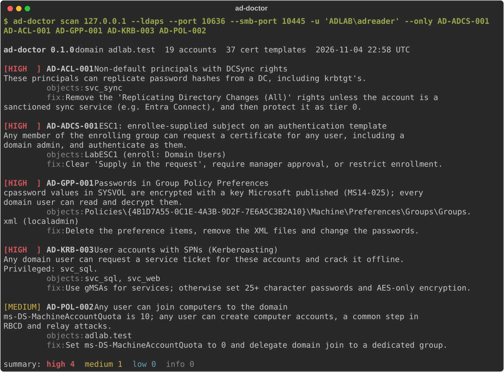
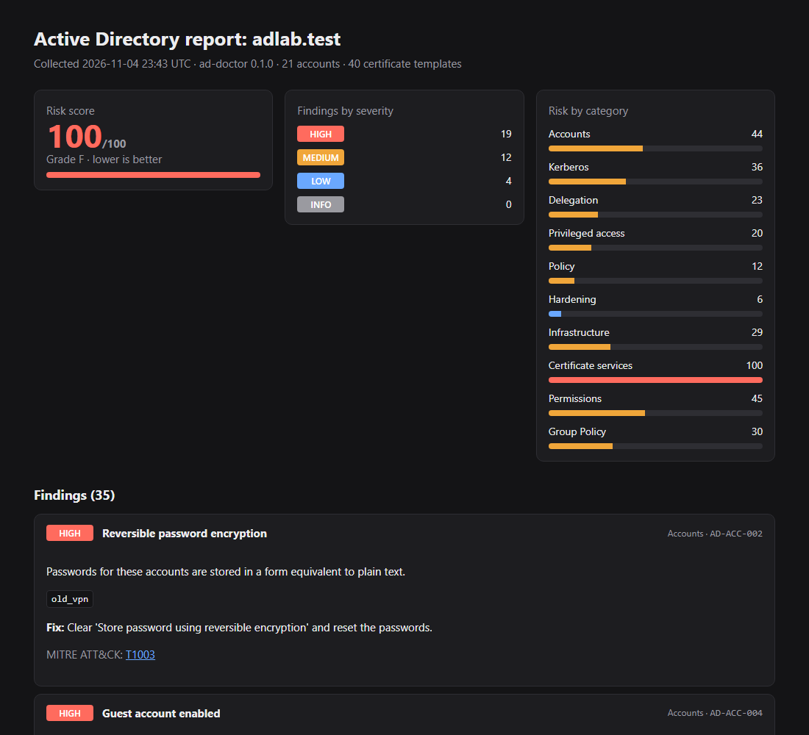
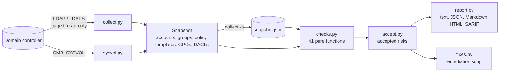

# ad-doctor

[](https://github.com/brkozer/ad-doctor/actions/workflows/ci.yml)
[](LICENSE)

Read-only Active Directory misconfiguration audit that fits in a pipeline.

ad-doctor binds as an ordinary domain user, takes one snapshot of the domain over LDAP
(plus SYSVOL over SMB) and runs 41 checks for the things attackers look for first:
roastable accounts, risky delegation, exploitable certificate templates (ESC1–5, 9, 13,
15), DCSync and other dangerous ACLs, editable GPOs on domain controllers, passwords left
in Group Policy, weak trusts and legacy settings. It writes nothing to the directory.

<p align="center"></p>

Both screenshots are real scans of the lab domain in [`lab/`](lab): a Windows Server 2025
DC seeded with one instance of every misconfiguration.

## What sets it apart

- **Runs from any machine.** Pure Python (developed and tested on Linux): no
  domain-joined host, no RSAT, no admin rights; a normal domain account and LDAPS are
  enough.
- **Built for CI.** SARIF 2.1.0 and JSON output, exit codes with `--fail-on`, and
  `--baseline` so a scheduled job fails only on *new* findings.
- **Offline analysis.** `collect` writes a JSON snapshot; `analyze` and `diff` work on it
  later, on another machine, without touching the domain again.
- **Accepted risks with an expiry.** A TOML file records who accepted what and why; an
  expired acceptance turns back into a finding.
- **A fix script you can review.** `--fixes fix.ps1` writes the PowerShell for each finding
  with `-WhatIf` on every change, so it is safe to run as-is and does nothing until an
  administrator removes the guards.
- **Tested against a real DC.** Every check that can be reproduced in one domain is
  planted in the lab and asserted by `tests/test_lab.py`, together with a check that the
  built-in objects do not produce false positives.

Tools like PingCastle and Purple Knight cover far more ground and Locksmith goes deeper
into AD CS; ad-doctor is the small, scriptable option for the checks that matter most.

<p align="center"></p>

## Checks

| Area | ID | Finding | Severity |
|---|---|---|---|
| Kerberos | AD-KRB-001 | krbtgt password older than 180 days | high |
| | AD-KRB-002 | Accounts without Kerberos pre-authentication (AS-REP roasting) | high |
| | AD-KRB-003 | User accounts with SPNs (Kerberoasting); high when privileged | medium/high |
| | AD-KRB-004 | Accounts limited to DES | medium |
| Delegation | AD-DEL-001 | Unconstrained delegation outside domain controllers | high |
| | AD-DEL-002 | Constrained delegation with protocol transition | medium |
| | AD-DEL-003 | Resource-based constrained delegation configured | low |
| Accounts | AD-ACC-001 | Enabled accounts allowed an empty password (`PASSWD_NOTREQD`) | medium |
| | AD-ACC-002 | Reversible password encryption | high |
| | AD-ACC-003 | Privileged accounts whose password never expires | medium |
| | AD-ACC-004 | Guest account enabled | high |
| | AD-ACC-005 | Enabled users inactive for 90+ days | low |
| | AD-ACC-006 | `adminCount` left on accounts that are no longer privileged | low |
| | AD-ACC-007 | SID history; high for privileged or same-domain SIDs | medium/high |
| Privileged access | AD-PRIV-001 | Tier-0 groups with more than 5 members | low |
| | AD-PRIV-002 | Privileged accounts that can be delegated | medium |
| | AD-PRIV-003 | Schema Admins or Enterprise Admins not empty | low |
| | AD-PRIV-004 | Members of DnsAdmins | medium |
| | AD-PRIV-005 | Anonymous or Everyone in Pre-Windows 2000 Compatible Access | medium |
| Policy | AD-POL-001 | Weak default password policy | medium |
| | AD-POL-002 | `ms-DS-MachineAccountQuota` above 0 | medium |
| Hardening | AD-SEC-001 | Computers without LAPS | medium |
| Infrastructure | AD-INF-001 | Computers on unsupported Windows versions; high for DCs | medium/high |
| | AD-INF-002 | AD Recycle Bin disabled | low |
| | AD-INF-003 | Domain functional level below Windows Server 2016 | low |
| | AD-INF-004 | Unsafe `dsHeuristics` (anonymous LDAP, AdminSDHolder exclusions) | medium/high |
| | AD-INF-005 | LDAP signing not required (active probe) | medium |
| | AD-INF-006 | Trusts without SID filtering or with TGT delegation | high |
| Certificate services | AD-ADCS-001 | ESC1: enrollee-supplied subject on an authentication template | high |
| | AD-ADCS-002 | ESC2: any-purpose or no-EKU template | high |
| | AD-ADCS-003 | ESC3: enrollment agent template open to broad groups | high |
| | AD-ADCS-004 | ESC4: broad groups can modify a certificate template | high |
| | AD-ADCS-005 | ESC5: non-tier-0 control over CA objects, templates or NTAuth | high |
| | AD-ADCS-006 | ESC9: authentication template without the security extension | high |
| | AD-ADCS-007 | ESC13: issuance policy linked to a group | high |
| | AD-ADCS-008 | ESC15: schema v1 template with enrollee-supplied subject | high |
| Permissions | AD-ACL-001 | Non-default principals with DCSync rights | high |
| | AD-ACL-002 | Non-default control over AdminSDHolder | high |
| | AD-ACL-003 | Non-default control over the domain object | high |
| Group Policy | AD-GPO-001 | GPOs linked to the domain or DC OU editable outside tier 0 | high |
| | AD-GPP-001 | Passwords in Group Policy Preferences (MS14-025) | high |

Template checks fire only for templates published on an enterprise CA that issue without
manager approval or authorized signatures and that broad groups (Domain Users, Domain
Computers, Authenticated Users, Everyone) can enroll in. "Non-default" and "outside tier
0" mean anyone except Domain/Enterprise/Schema Admins, Administrators, domain controllers
and SYSTEM. Every finding carries its MITRE ATT&CK techniques (`ad-doctor checks -f json`).

The risk score adds 15 per high, 6 per medium and 2 per low finding, capped at 100;
grades run from A (10 or less) to F (above 70). It is meant for tracking one domain over
time, not for comparing domains.

## Usage

```bash
uv tool install git+https://github.com/brkozer/ad-doctor

# collect and analyze in one go (password from AD_DOCTOR_PASSWORD or a prompt)
ad-doctor scan dc01.corp.example --ldaps -u 'CORP\auditor'

# HTML report and a reviewable remediation script
ad-doctor scan dc01.corp.example --ldaps -u 'CORP\auditor' -f html -o report.html --fixes fix.ps1

# collect once, analyze and compare offline
ad-doctor collect dc01.corp.example --ldaps -u 'CORP\auditor' -o 2026-11.json
ad-doctor analyze 2026-11.json -f markdown -o report.md
ad-doctor diff 2026-10.json 2026-11.json
```

| Option | |
|---|---|
| `-f text\|json\|markdown\|html\|sarif`, `-o FILE` | report format and destination |
| `--fail-on high\|medium\|low` | exit 2 when a finding at that severity exists |
| `--baseline FILE` | mark findings missing from an earlier report or snapshot as new; `--fail-on` then considers only those |
| `--accept FILE` | accepted risks (see [`examples/accept.toml`](examples/accept.toml)) |
| `--fixes FILE` | write the PowerShell remediation script |
| `--only ID ...` | run a subset of checks (`ad-doctor checks` lists them) |
| `--no-sysvol`, `--smb-port` | skip or redirect the SMB part |
| `--signing-probe-port PORT` | plain LDAP port for the signing probe; `0` skips it |

Parts that cannot run (no AD CS, SYSVOL unreachable, no NTLM account for the signing
probe) become notes in the report instead of failing the scan. Domain controllers that
require LDAP signing (the default on Windows Server 2025) reject plain LDAP binds, so use
`--ldaps` for the scan itself.

### In CI

```yaml
- run: uvx --from git+https://github.com/brkozer/ad-doctor ad-doctor scan "$DC" --ldaps -u "$AD_USER" -f sarif -o ad.sarif --baseline last.json --fail-on high
  env: { AD_DOCTOR_PASSWORD: "${{ secrets.AD_PASSWORD }}" }
- uses: github/codeql-action/upload-sarif@v3
  if: always()
  with: { sarif_file: ad.sarif }
```

## What it needs and what it reads

An enabled domain user is enough; no group memberships or delegated rights. ad-doctor
reads the domain object, users, computers, groups, trusts, the GPOs linked to the domain
and the Domain Controllers OU, AD CS templates, enrollment services and OIDs, and the
DACLs of the security-critical objects. DACLs are requested with the SD flags control,
which ordinary users may read, and parsed by a small built-in parser (`sd.py`). From
SYSVOL it keeps only file paths and account names, never the `cpassword` values. The only
active test is the LDAP signing probe: one unsigned NTLM bind on port 389, closed right
after.

## Limits

- One domain per run; trusts are inspected from this side only.
- CA-side settings that LDAP cannot see (ESC6, ESC7, ESC8, ESC11, ESC16) are out of scope;
  so are channel binding, SMB signing and per-host settings such as the Print Spooler.
- Deny ACEs are ignored, which can only over-report, never hide a finding.
- AD-KRB-001 and AD-ACC-005 depend on time passing, and AD-ACC-007 and AD-INF-006 need a
  second domain, so the live lab cannot exercise them; the unit tests do.

## How it works



Checks never touch the network, which keeps them fast and lets the unit tests run
without a domain controller; the collector itself is tested against a fake LDAP
connection.

## Development

```bash
uv sync
uv run ruff check . && uv run mypy && uv run pytest
```

[`lab/`](lab) builds a disposable Windows Server 2025 evaluation DC under KVM and seeds
it; see [lab/README.md](lab/README.md). With the lab running:

```bash
AD_DOCTOR_LAB_HOST=127.0.0.1 AD_DOCTOR_LAB_PORT=10636 AD_DOCTOR_LAB_SMB_PORT=10445 \
AD_DOCTOR_LAB_PLAIN_PORT=10389 AD_DOCTOR_LAB_USER='ADLAB\adreader' AD_DOCTOR_PASSWORD=... \
uv run pytest -m lab

uv run python scripts/demo_svg.py docs/demo.svg   # regenerate the terminal screenshot
```

## License

MIT
