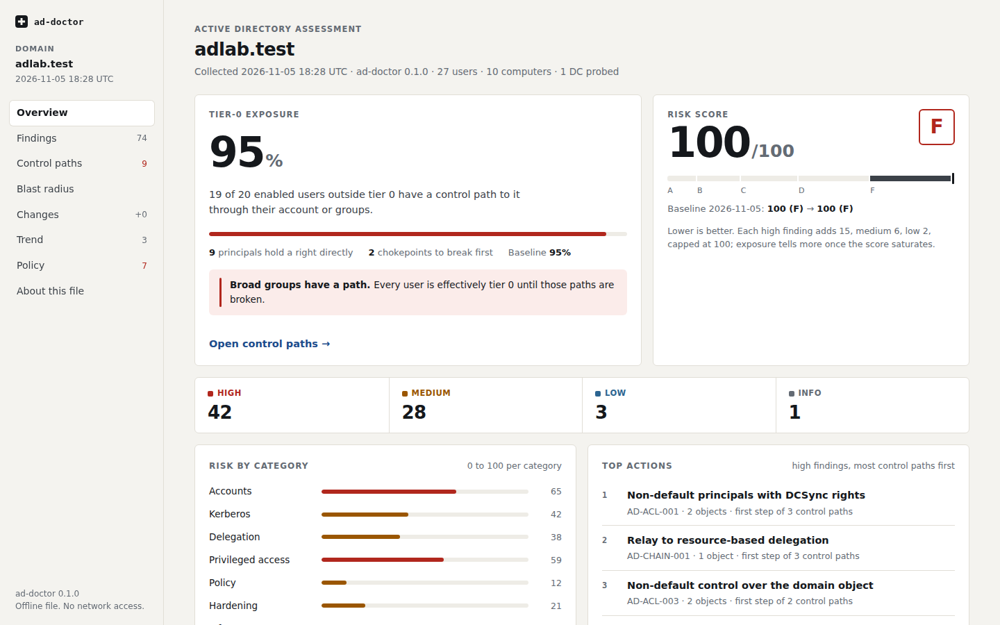
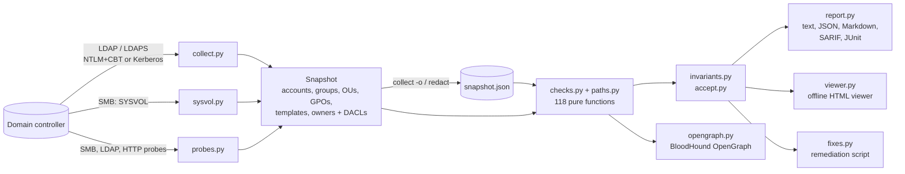
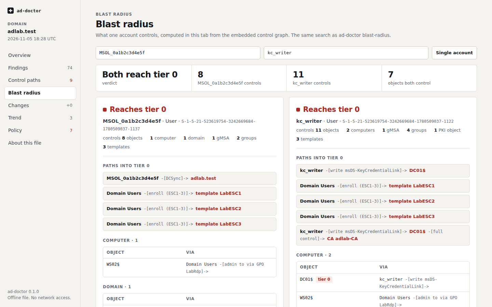
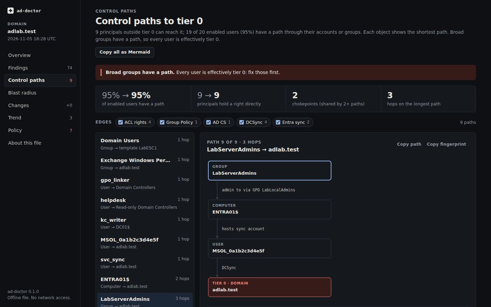

# ad-doctor

[](https://github.com/brkozer/ad-doctor/actions/workflows/ci.yml)
[](https://pypi.org/project/ad-doctor/)
[](https://github.com/brkozer/ad-doctor/releases)
[](LICENSE)

Read-only Active Directory security audit that fits in a pipeline.

ad-doctor binds as an ordinary domain user, takes one snapshot of the domain over LDAP
(plus SYSVOL and a few cheap probes of every DC over SMB, LDAP and HTTP) and runs 118
checks for what attackers look for first: roastable accounts, risky delegation,
exploitable certificate templates and CA settings (ESC1–9, 11, 13–17), DCSync and other takeover rights,
shadow credentials, BadSuccessor, PrivExchange, exposed Entra Connect sync accounts,
editable GPOs on domain controllers, local admin and remote logon rights handed out by
Group Policy, passwords in Group Policy and scripts, relay-friendly DCs, weak trusts and
legacy configuration. It then finds every control path from a
non-admin to tier 0. It writes nothing to the directory.

<p align="center"></p>

The screenshots are real scans of the lab domain in [`lab/`](lab), a Windows Server 2025
DC seeded with the misconfigurations `seed.ps1` plants. They were taken before the lab's
latest additions, so the counts in them are lower than a scan shows today.

## What sets it apart

- **Attack paths without a graph database.** `AD-PATH-001` builds the control graph
  (group membership, takeover ACEs, ownership, DCSync, GPO links and what those GPOs reach
  through OUs and sites, exploitable templates,
  gMSA readers, local admin rights that Group Policy hands out, an Entra Connect server
  holding its sync account, delegation to computers, SID history, issuance-policy groups
  (ESC13), ESC6 with ESC16 on the CA) from the snapshot and
  reports the shortest path from every non-tier-0
  principal to tier 0, plus the share of users that have one. `ad-doctor blast-radius`
  answers "what does this account control if it is phished?".
- **Plays well with BloodHound.** `ad-doctor export-graph` writes the same graph as a
  BloodHound OpenGraph payload. Principals keep their SIDs, so the edges attach to an
  existing SharpHound graph of the domain instead of building a second one. It is a generic
  graph, so BloodHound offers Search and Cypher on it, not Pathfinding; the paths themselves
  come from ad-doctor. Remote logon rights that GPOs grant (RDP, WinRM, DCOM) are marked
  `traversable: false`, a property for your own queries: logon is not control, so ad-doctor's
  path search does not follow them.
- **Every DC, not just one.** LDAP signing, SMB signing, the spooler and channel binding
  are probed on each domain controller, and findings name the ones that drift from the
  rest; DCs that cannot be reached are reported rather than assumed fine.
- **Fast on large domains.** 100,000 users, 33,000 computers and 127,000 ACEs load in
  about 4 s and go through every check, attack paths included, in about 10 s on one 2017
  Xeon core
  ([benchmark](#performance)).
- **Compound findings.** `AD-CHAIN-*` raise the alarm when individually medium findings
  add up to a known one-step compromise (relay to RBCD, coercion plus unconstrained
  delegation, coercion plus ESC8).
- **A report you can hand over, as one offline file.** `ad-doctor view` writes a single
  HTML file with the findings, the control paths drawn step by step, the places where one
  change breaks the most paths, any account's blast radius, the changes since a baseline,
  the trend across earlier scans, and accepted risks and invariants, with a builder for
  new acceptances. It has no server, loads nothing and cannot make a request: a
  Content-Security-Policy allows only its own inlined script and style. With the control
  graph inside, it is encrypted with a passphrase by default (AES-256-GCM, opened with
  WebCrypto) ([details](#the-html-viewer)).
- **Built for CI and change management.** SARIF 2.1.0 (validated against the schema),
  JUnit, JSON with stable per-finding fingerprints, exit codes with `--fail-on`, and
  `--baseline` / `diff` so a scheduled job fails only on *new* findings.
- **Policy as code.** An `invariants.toml` declares the expected state (exact tier-0
  membership, allowed DCSync principals, published templates, required settings); any
  drift becomes a finding.
- **Accepted risks with owners and expiry.** Expired acceptances turn back into findings,
  acceptances that no longer match anything are reported as stale, and the ones expiring
  within 30 days are listed.
- **A remediation plan with a proof.** `ad-doctor plan` finds the cheapest set of
  removals that closes the control paths and says when it is a proven minimum;
  `ad-doctor whatif` shows what given removals would close, reroute or leave open, and
  which findings would clear or appear, on the snapshot, never on AD
  ([details](#what-if-and-plan)).
- **A fix script you can review.** `--fixes fix.ps1` writes the PowerShell for each
  finding with `-WhatIf` on every change (commented out where there is no dry-run), so it
  is safe to run as-is.
- **Shareable snapshots.** `ad-doctor redact` pseudonymizes names, DNs, hosts and the
  domain SID with a keyed HMAC, so a snapshot can go to a consultant or a bug report and
  still produce the same findings.
- **Runs from any Linux box** with an ordinary account: no domain-joined host, no RSAT,
  no admin rights. NTLM with channel binding (works where the DC enforces it) or Kerberos
  from a ticket cache.

Tools like PingCastle and Purple Knight cover more ground overall and Locksmith goes
deeper into AD CS; ad-doctor is the scriptable option, and the one that tests itself
against a live DC.

<p align="center"></p>

## Checks

| Area | ID | Finding | Severity |
|---|---|---|---|
| Kerberos | AD-KRB-001 | krbtgt password older than 180 days | high |
| | AD-KRB-002 | Accounts without Kerberos pre-authentication (AS-REP roasting) | high |
| | AD-KRB-003 | User accounts with SPNs (Kerberoasting); high when privileged | medium/high |
| | AD-KRB-004 | Accounts limited to DES | medium |
| | AD-KRB-005 | RC4 readiness: RC4-only values, reliance on the default, suspected missing AES keys, DC values (reads configuration, not keys) | low/medium |
| | AD-KRB-006 | Seamless SSO (`AZUREADSSOACC$`) key not rolled over in 30 days | medium |
| | AD-KRB-007 | Entra Kerberos objects to review: key age and look-alikes | low |
| Delegation | AD-DEL-001 | Unconstrained delegation outside domain controllers | high |
| | AD-DEL-002 | Constrained delegation with protocol transition | medium |
| | AD-DEL-003 | Resource-based constrained delegation configured | low |
| | AD-DEL-004 | Delegation to DC services or krbtgt, RBCD on DCs | high |
| | AD-DEL-005 | Constrained delegation to SPNs no account holds (ghost SPNs, HOST aliases and `sPNMappings` resolved) | low/medium/high |
| Accounts | AD-ACC-001 | Enabled accounts allowed an empty password (`PASSWD_NOTREQD`) | medium |
| | AD-ACC-002 | Reversible password encryption | high |
| | AD-ACC-003 | Privileged accounts whose password never expires | medium |
| | AD-ACC-004 | Guest account enabled | high |
| | AD-ACC-005 | Enabled users inactive for 90+ days | low |
| | AD-ACC-006 | `adminCount` left on accounts that are no longer privileged | low |
| | AD-ACC-007 | SID history; high for privileged or same-domain SIDs | medium/high |
| | AD-ACC-008 | Passwords in `description` or `info` (text never reproduced) | medium |
| | AD-ACC-009 | Readable `userPassword` / `unixUserPassword` / `msSFU30Password` | high |
| | AD-ACC-010 | Pre-created computers whose password is their name | high |
| | AD-ACC-011 | Privileged passwords older than a year | medium |
| | AD-ACC-012 | `pwdLastSet` newer than the real password change on tier-0 accounts | medium/high |
| | AD-ACC-013 | Key credentials or strong certificate mappings on tier-0 accounts | low/medium/high |
| | AD-ACC-014 | Stale enabled computer accounts | low |
| | AD-ACC-015 | gMSA passwords with a long rotation interval | low |
| | AD-ACC-016 | Identity collisions to review: UPN, SPN and host name | low |
| Privileged access | AD-PRIV-001 | Tier-0 groups with more than 5 members | low |
| | AD-PRIV-002 | Privileged accounts that can be delegated | medium |
| | AD-PRIV-003 | Schema Admins or Enterprise Admins not empty | low |
| | AD-PRIV-004 | Members of DnsAdmins | medium |
| | AD-PRIV-005 | Anonymous or Everyone in Pre-Windows 2000 Compatible Access | medium |
| | AD-PRIV-006 | Disabled, computer or foreign accounts in tier-0 groups | medium |
| | AD-PRIV-007 | Membership hidden through `primaryGroupID` | high |
| | AD-PRIV-008 | Operator groups not empty | medium |
| | AD-PRIV-009 | Cert Publishers members that are not CA servers | medium |
| | AD-PRIV-010 | Protected Users not used for administrators | info |
| | AD-PRIV-011 | Entra Connect sync account can DCSync and its server is not protected as tier 0 | medium |
| | AD-PRIV-012 | Tier-0 group members the scanning account cannot read | high |
| Policy | AD-POL-001 | Weak default password policy | medium |
| | AD-POL-002 | `ms-DS-MachineAccountQuota` above 0 | medium |
| | AD-POL-003 | Weak fine-grained password policies | low/medium |
| Hardening | AD-SEC-001 | Windows computers without LAPS | medium |
| | AD-SEC-002 | LAPS passwords readable by the scanning account | high |
| Infrastructure | AD-INF-001 | Computers on unsupported Windows versions; high for DCs | medium/high |
| | AD-INF-002 | AD Recycle Bin disabled | low |
| | AD-INF-003 | Domain functional level below Windows Server 2016 | low |
| | AD-INF-004 | Unsafe `dsHeuristics` (anonymous LDAP or NSPI, AdminSDHolder exclusions, uniqueness, encryption and CVE-2021-42291 checks off, List Object mode) | low/medium/high |
| | AD-INF-005 | LDAP signing not required (probe, every DC) | medium |
| | AD-INF-006 | Trusts without SID filtering or with TGT delegation | high |
| | AD-INF-007 | BadSuccessor: dMSA creation rights outside tier 0 (2025 domains) | high |
| | AD-INF-008 | SMB signing not required (probe, every DC) | high |
| | AD-INF-009 | Print Spooler running (probe, every DC); high with unconstrained delegation | medium/high |
| | AD-INF-010 | LDAPS channel binding not enforced (probe, every DC) | medium |
| | AD-INF-011 | No backup of the domain partition in 7 days | medium |
| | AD-INF-012 | RODCs that may cache privileged credentials | medium |
| | AD-INF-013 | Domain controllers the probes could not reach | low |
| | AD-INF-014 | Rogue DC candidates: DC flag without an NTDS Settings object | medium/high |
| | AD-INF-015 | Trusts limited to old protocols: downlevel, or no AES | low/medium |
| | AD-INF-016 | Trusts unchanged for over 40 days | low/medium |
| | AD-INF-017 | Forest trusts without Selective Authentication | medium |
| | AD-INF-018 | Domain controllers with an old machine password | low/medium |
| | AD-INF-019 | SYSVOL still replicated by FRS | low/medium |
| | AD-INF-020 | Sites and subnets that need review | low |
| | AD-INF-021 | Replication conflict objects and duplicate accounts | low/medium |
| Certificate services | AD-ADCS-001 | ESC1: enrollee-supplied subject on an authentication template | high |
| | AD-ADCS-002 | ESC2: any-purpose or no-EKU template | high |
| | AD-ADCS-003 | ESC3: enrollment agent template open to broad groups | high |
| | AD-ADCS-004 | ESC4: broad groups can modify a certificate template | high |
| | AD-ADCS-005 | ESC5: non-tier-0 control over CA objects, templates or NTAuth | high |
| | AD-ADCS-006 | ESC9: authentication template without the security extension | medium |
| | AD-ADCS-007 | ESC13: issuance policy linked to a group | high |
| | AD-ADCS-008 | ESC15: schema v1 template with enrollee-supplied subject | high |
| | AD-ADCS-009 | ESC14: weak explicit certificate mappings | medium/high |
| | AD-ADCS-010 | ESC8: web enrollment accepts NTLM over HTTP (probe) | high |
| | AD-ADCS-011 | Published templates allowing RSA keys under 2048 bits | medium |
| | AD-ADCS-012 | ESC6: CA accepts a SAN from request attributes (registry probe) | medium/low |
| | AD-ADCS-013 | ESC7: non-tier-0 principals manage the CA (ManageCA high; ManageCertificates graded by what it reaches) | medium/high |
| | AD-ADCS-014 | ESC11: CA does not require encryption for ICPR requests (registry probe) | high/medium |
| | AD-ADCS-015 | ESC16: CA leaves out the SID security extension (registry probe) | medium/low |
| | AD-ADCS-016 | CA configuration could not be read (registry probe) | low |
| | AD-ADCS-017 | ESC17: enrollee-supplied subject on a server authentication template | medium |
| | AD-ADCS-018 | CA audit filter not fully on (registry probe) | low/medium |
| | AD-ADCS-019 | HTTPS enrollment endpoints where EPA is not verified (probe) | low |
| | AD-ADCS-020 | ESC10: weak certificate mapping set by Group Policy on domain controllers | info/medium |
| Permissions | AD-ACL-001 | Non-default principals with DCSync rights | high |
| | AD-ACL-002 | Non-default control over AdminSDHolder | high |
| | AD-ACL-003 | Non-default control over the domain object | high |
| | AD-ACL-004 | Takeover rights or ownership on tier-0 accounts, groups and DCs (shadow credentials, RBCD, members, password reset, SPN) | high |
| | AD-ACL-005 | AdminSDHolder inherits permissions | high |
| | AD-ACL-006 | gMSA passwords readable outside tier 0 | high |
| | AD-ACL-007 | Exchange groups with WriteDacl over the domain (PrivExchange); medium when only inherited | medium/high |
| | AD-ACL-008 | Entra Connect sync account or server controllable outside tier 0 | high |
| | AD-ACL-009 | Control over dMSAs that replace another account | low/medium |
| Group Policy | AD-GPO-001 | GPOs linked to the domain or DC OU editable outside tier 0 | high |
| | AD-GPO-002 | Non-tier-0 principals can link GPOs to the domain or DCs | high |
| | AD-GPO-003 | NTLMv1/LM, LM hashes, reversible encryption or dangerous privileges in those GPOs | medium/high |
| | AD-GPO-004 | Other GPOs editable outside tier 0 | medium |
| | AD-GPO-005 | GPOs make broad groups local administrators (Restricted Groups, GPP Local Groups) | high |
| | AD-GPO-006 | GPOs make non-tier-0 principals admins of tier-0 servers (DCs, CAs, Entra Connect, Exchange) | high |
| | AD-GPO-007 | GPOs grant RDP, WinRM or DCOM to broad groups (medium) or on tier-0 servers (high) | medium/high |
| | AD-GPO-008 | Onelogon: GPOs set the Netlogon vulnerable channel allow list on DCs | medium/high |
| | AD-GPO-009 | LLMNR not turned off by Group Policy | info/low/medium |
| | AD-GPO-010 | Group Policy points computers to WSUS over HTTP | info/medium/high |
| | AD-GPO-011 | PowerShell script block or module logging not set by Group Policy | info/low/medium |
| | AD-GPO-012 | UNC hardened paths for SYSVOL and NETLOGON missing or weak | info/medium |
| | AD-GPO-013 | Domain controllers' audit policy below Microsoft's recommendation | info/low/medium |
| | AD-GPO-014 | Group Policy sets automatic logon or stores its password (values never reproduced) | info/high |
| | AD-GPO-015 | Group Policy keeps NTLMv1-derived single sign-on in audit mode | info/low |
| | AD-GPO-016 | Group Policy allows weak Kerberos types as the domain default | info/low/medium |
| | AD-GPP-001 | Passwords in Group Policy Preferences (MS14-025) | high |
| | AD-GPP-002 | Credentials in SYSVOL or NETLOGON scripts (values never reproduced) | high |
| Attack paths | AD-PATH-001 | Control paths from non-tier-0 principals to tier 0 | high |
| | AD-CHAIN-001 | Relay to RBCD (signing or channel binding off, plus machine account quota) | high |
| | AD-CHAIN-002 | Coercion plus unconstrained delegation (high with a confirmed spooler, else coercion assumed) | high/medium |
| | AD-CHAIN-003 | Coercion plus web enrollment relay (ESC8); medium when GPOs deny outgoing NTLM on every DC | medium/high |
| | AD-CHAIN-004 | ESC6 plus ESC16 on the same CA (SID in a SAN under strong mapping) | high/medium |

Template checks fire only for templates published on an enterprise CA that issue without
manager approval or authorized signatures and that broad groups (Domain Users, Domain
Computers, Authenticated Users, Everyone) can enroll in. "Tier 0" means
Domain/Enterprise/Schema Admins, Administrators, the operator groups, domain controllers,
SYSTEM and the built-in Administrator; for the Group Policy local group checks, tier-0
servers are DCs, CA hosts, Entra Connect servers, Exchange servers and computers that are
in a tier-0 group or hold DCSync. Well-known delegations (SELF, Key Admins on
`msDS-KeyCredentialLink`, Cert Publishers and the CA server on PKI objects) are not
reported. Every finding carries its MITRE ATT&CK techniques (`ad-doctor checks -f json`).

The risk score adds 15 per high, 6 per medium and 2 per low finding, capped at 100;
grades run from A (10 or less) to F (above 70). It is meant for tracking one domain over
time, not for comparing domains.

## Documentation

Full docs, including a page for every check, are at
<https://brkozer.github.io/ad-doctor/>.
The same per-check explanation is available offline:

```bash
ad-doctor explain AD-ADCS-001      # by ID
ad-doctor explain esc1             # or by alias
ad-doctor explain AD-KRB-003 -f markdown
```

Every finding in a Markdown, JUnit or SARIF report and in the fix script links to its
catalog page (the HTML viewer, which links nowhere, shows the URL as text to copy), and
SARIF rules carry the explanation and a `helpUri` so code-scanning alerts show it too.

## Usage

```bash
uv tool install ad-doctor        # or: pipx install ad-doctor; ad-doctor[kerberos] adds Kerberos

# scan (password from AD_DOCTOR_PASSWORD or a prompt)
ad-doctor scan dc01.corp.example --ldaps -u 'CORP\auditor'

# HTML report and a reviewable remediation script
ad-doctor scan dc01.corp.example --ldaps -u 'CORP\auditor' -f html -o report.html --fixes fix.ps1

# Kerberos from the current ticket cache (kinit first; use the DC's host name)
ad-doctor scan dc01.corp.example --ldaps -k

# collect once, analyze and compare offline
ad-doctor collect dc01.corp.example --ldaps -u 'CORP\auditor' -o 2026-11.json
ad-doctor analyze 2026-11.json -f markdown -o report.md --invariants invariants.toml
ad-doctor diff 2026-10.json 2026-11.json
ad-doctor blast-radius 2026-11.json helpdesk_jane
ad-doctor paths 2026-11.json --chokepoints        # where one change breaks the most paths
ad-doctor view 2026-11.json --baseline 2026-10.json --accept accept.toml --fixes --open
AD_DOCTOR_REDACT_KEY=... ad-doctor redact 2026-11.json -o shareable.json

# the control graph for BloodHound CE (File Ingest accepts OpenGraph JSON)
ad-doctor export-graph 2026-11.json -o graph.json --paths-only
```

| Option | |
|---|---|
| `-f text\|json\|markdown\|html\|sarif\|junit`, `-o FILE` | report format and destination |
| `--fail-on high\|medium\|low` | exit 2 when a finding at that severity exists |
| `--baseline FILE` | mark findings missing from an earlier report or snapshot as new; `--fail-on` then considers only those |
| `--accept FILE` | accepted risks (see [`examples/accept.toml`](examples/accept.toml)) |
| `--invariants FILE` | declared state to enforce (see [`examples/invariants.toml`](examples/invariants.toml)) |
| `--fixes FILE` | write the PowerShell remediation script |
| `--only ID ...` | run a subset of checks (`ad-doctor checks` lists them) |
| `view FILE`, `--open` | write the offline HTML viewer from a snapshot or a JSON report (`--baseline`, `--accept`, `--invariants`, `--fixes` as above; `--history DIR` for the trend, `--graph auto\|full\|paths\|none` for blast radius, `--encrypt`/`--no-encrypt`) |
| `paths FILE --chokepoints` | list the control paths to tier 0, or rank the steps they share (`-f text\|json\|mermaid`) |
| `explain ID\|alias` | print a check's full explanation and fix offline (`-f text\|markdown\|json`, `--web`) |
| `-k`, `--kerberos` | bind with Kerberos instead of a password |
| `--no-sysvol`, `--smb-port` | skip or redirect the SMB part |
| `--no-probes`, `--http-port`, `--https-port` | skip every probe (LDAP signing, SMB, channel binding, enrollment, CA registry; SYSVOL has its own `--no-sysvol`), or move the web enrollment ports (0 skips one) |
| `--no-ca-registry` | skip reading CA settings (ESC6/7/11/16, audit filter) over `\pipe\winreg` |
| `--single-dc` | probe only the DC being scanned instead of every DC in the domain |
| `--signing-probe-port PORT` | plain LDAP port for the signing probe; `0` skips it |

Parts that cannot run (no AD CS, SYSVOL unreachable, Kerberos without an NTLM account for
the signing probes) become notes in the report instead of failing the scan. Domain
controllers that require LDAP signing (the default on Windows Server 2025) reject plain
LDAP binds, so use `--ldaps`.

### In CI

```yaml
- run: uvx ad-doctor scan "$DC" --ldaps -u "$AD_USER" -f sarif -o ad.sarif --baseline last.json --fail-on high
  env: { AD_DOCTOR_PASSWORD: "${{ secrets.AD_PASSWORD }}" }
- uses: github/codeql-action/upload-sarif@v3
  if: always()
  with: { sarif_file: ad.sarif }
```

## What it needs and what it reads

An enabled domain user is enough; no group memberships or delegated rights. ad-doctor
reads users, computers, groups, OUs, GPOs, trusts, AD CS templates, enrollment services
and OIDs, gMSAs, the replication metadata of the domain head (for the backup date) and
of tier-0 accounts (for the real password change, in the BASE read it does anyway),
`msDS-KeyCredentialLink` and `msDS-ReplValueMetaData` of tier-0 accounts, CA servers and
Entra Connect sync accounts and servers (the keys themselves are not kept), `sPNMappings`
on `CN=Directory Service`, and
the owners and DACLs of the security-critical objects, the `server` and `nTDSDSA` objects
under `CN=Sites` and the `crossRef` objects under `CN=Partitions`. A `member` value of a
tier-0 group that no search returned gets one BASE read, at most 500 per scan. Security descriptors are requested
with the SD flags control for owner and DACL, which ordinary users may read, and parsed
by a small built-in parser (`sd.py`). For Group Policy scope it also reads `gPLink` and
`gPOptions` on the domain, OUs and sites, the GPOs' status, version and extension
attributes, WMI filter names and which site each DC is in. From SYSVOL it reads Group
Policy Preferences (passwords and Local Groups), `GptTmpl.inf` security templates
(including Restricted Groups), `Machine\Registry.pol`, advanced audit policy (`audit.csv`), Preferences
`Registry.xml` and scripts, and keeps only paths, line numbers, account names and setting
values, never a secret. From `Registry.pol` it keeps
only the values its checks read; a value named like a password is reported by location alone.

Active probes, each one connection per DC: an unsigned NTLM bind on 389 (LDAP signing),
an NTLM bind on LDAPS without a channel binding token, an SMB negotiate plus an attempt
to open the `spoolss` pipe, an unauthenticated `GET /certsrv/` on each CA over HTTP and
over HTTPS, and the same `GET` to each URL in `msPKI-Enrollment-Servers` (CES). On each
enterprise CA it also reads the CA's own configuration (ESC6, ESC7, ESC11, ESC16, audit
filter) over
`\pipe\winreg` (MS-RRP) with a small built-in client: every call is a `KEY_READ`, nothing
is written. Opening that pipe trigger-starts the RemoteRegistry service on the CA host if
it is set to start on demand (a visible change of service state), and remote registry
access to `CertSvc` is the kind of thing EDR and Microsoft Defender for Identity may alert
on; `--no-ca-registry` skips just that read. The DC being scanned is reached through the
address and ports given on the command line, the others by their DNS names on the standard
ports. A CES URL is reached on the port it names; only a URL with no port follows
`--http-port` or `--https-port`. `--single-dc`, `--no-probes`, `--no-ca-registry` and
`--signing-probe-port 0` narrow or turn them off, and `--no-sysvol` skips SYSVOL, which
`--no-probes` leaves on; [SECURITY.md](SECURITY.md) lists every probe.

## Limits

- One domain per run; trusts are inspected from this side only.
- CI runs on Python 3.12 and 3.13 only.
- The CA-side checks (ESC6, ESC7, ESC11, ESC16, audit filter) read the CA's registry over
  `\pipe\winreg`, which needs TCP 445 to each CA and credentials; a run that cannot reach a
  CA, where RemoteRegistry is disabled, or where a GPO has removed `CertSvc` from the
  winreg AllowedPaths reports AD-ADCS-016 rather than a clean result. A third-party policy
  module leaves ESC6 and ESC16 unknown, and a value that is absent or unparseable leaves its
  check unknown (both reported by AD-ADCS-016, never "clean"). ESC7 reads the CA security
  descriptor: on a CA that is a member server, `BUILTIN\Administrators` there is that
  server's *local* Administrators group, whose members are invisible over LDAP. Deny ACEs
  in it are applied for the same SID, Everyone and Authenticated Users, not through other
  group memberships. The admins of other domains in the forest are expected CA managers
  when a within-forest trust object gives their domain's SID; on a CA outside the scanned
  domain with no such trust object, any other domain's Administrator and Domain Admins are
  accepted. ESC10 is checked only as far as Group Policy shows it (AD-ADCS-020): both
  values are commonly set locally on a DC, where an ordinary user cannot read them. ESC12
  (a CA key on an HSM reachable from a shell on the CA) is not checked. HTTPS web enrollment and the CES URLs
  in the directory are found, but whether they enforce EPA is not determined: IIS shows that
  only to a client that authenticates, and the probe sends these endpoints no credentials,
  so AD-ADCS-019 lists them as unknown. Host settings beyond what the DC probes see remain
  out of scope: local group membership that Group Policy sets is covered, changes made
  directly in a computer's local SAM are not.
- GPO reach in the control graph uses the links, Enforced, Block Inheritance, the user and
  computer side flags and security filtering described below. An empty GPO counts,
  because its writer fills it in. Not evaluated: WMI filters (assumed to match, with a
  caveat), Deny ACEs, loopback processing, and whether a user in scope ever logs on. With
  more than one site, a site link is followed only to the domain controllers of that site
  (noted), so paths through member computers there are missed.
- Group Policy scope for local groups (AD-GPO-005 to -007 and the graph edges) is worked
  out offline and errs toward over-reporting. Links, Block Inheritance, Enforced, disabled
  links, the GPO status, an empty computer version or a missing client-side extension, and
  security filtering (Read plus Apply Group Policy for any SID in the computer's token,
  well-known SIDs and foreignSecurityPrincipals included) are evaluated. Not evaluated:
  WMI filters (assumed to match), item-level targeting (the item is listed as applying,
  with a caveat), Deny ACEs in GPO permissions, member computers' sites (with more than one site,
  every site's links are assumed to apply), removals and precedence between GPOs (the
  result is the union of additions, though a higher-precedence `X__Members` can remove
  what another GPO adds), groups of other domains in the token, user-side GPP groups
  (noted), and `SeDenyRemoteInteractiveLogonRight` (a deny-RDP setting does not silence
  AD-GPO-007). Remote Desktop Users counts only where `SeRemoteInteractiveLogonRight`
  includes it; without a GPO that sets it, the Windows default applies (Administrators
  only on DCs, Administrators and Remote Desktop Users elsewhere). A holder of that right
  named by an account name that cannot be resolved is assumed to include the member, with
  a caveat.
- Domain controllers have no local groups: Restricted Groups that reach a writable DC
  rewrite the *domain* group with that SID and are reported as such, and an empty
  `X__Members =` line there (GPMC writes one whenever only "This group is a member of" is
  set) empties domain group X, which the scan notes. GPP Local Groups items are processed
  on DCs but leave domain groups alone (checked on Windows Server 2025), so they are
  skipped with a note; RODCs are skipped with a note.
- AD-GPO-003 judges only GPOs Windows would apply: a GPO with computer version 0, without
  the security extension in `gPCMachineExtensionNames`, or with its computer side disabled
  is not reported, whatever its `GptTmpl.inf` says.
- Exchange and Entra Connect are recognised from their directory footprint (the groups
  Exchange setup creates, `MSOL_` sync accounts); the lab seeds that footprint without
  installing either product.
- Deny ACEs on directory objects are ignored, which can only over-report, never hide a
  finding (the CA's own descriptor is the exception, see above).
- AD-KRB-005 reads configuration, not keys: stored keys are not visible over LDAP, so
  "suspected no AES keys" is a heuristic based on the age of the password.
  `DefaultDomainSupportedEncTypes`, the DCs' update level and what clients ask for are
  not visible either.
- `pwdLastSet` is checked against replication metadata for tier 0 only (AD-ACC-012);
  elsewhere it is taken at face value. Metadata that does not come back is noted.
- AD-ACC-013 reads key credentials on tier 0 only, and cannot say who wrote a key: Windows
  Hello for Business looks the same as a planted key. A key this account may not read still
  shows through replication metadata; where that metadata does not come back, the account
  is named in a note and not judged.
- AD-GPO-008 only sees GPOs. No finding means no GPO reaching a DC sets
  `VulnerableChannelAllowList`: a value in a DC's own registry needs admin rights to read.
  Precedence between GPOs is not worked out, and a Deny for a group does not take its
  members off the list.
- AD-GPO-009 to -012 use the effective value of a registry policy per computer, worked out
  from `Registry.pol` with link order, Enforced, Block Inheritance and security filtering. A
  WMI filter, an assumed site or an unreadable GPO that could change the result gives an
  info row, not a verdict. Only GPOs are visible: "no GPO sets it" says nothing about a value
  in a computer's own registry or local policy. Registry items in Group Policy Preferences do
  not count for these four; a note names the GPOs that have them. Deny ACEs on a GPO are not
  read.
- AD-GPO-013 to -016 and AD-ADCS-020 read `audit.csv` and `Registry.xml` with the same
  precedence; `Registry.xml` is played after every `Registry.pol`. A file that does not parse
  is a note and leaves its checks undecided. Audit policy is judged against Microsoft's
  baseline for domain controllers; basic `[Event Audit]` policy alone gives an info row, as
  whether it applies depends on a value on the computer. These checks and AD-GPO-009 to -012
  see Group Policy only. Values set through `GptTmpl.inf` registry entries are not read for
  certificate mapping, BlockNtlmv1SSO or the default Kerberos types.
- AD-ADCS-018 reads the CA's audit filter only. Whether the Certification Services audit
  subcategory is on is not read, so 127 does not prove events are written. A CA where
  auditing was never configured has no such value, and is reported as not set.
- AD-ACC-014 treats the newest of logon, password change and creation as last activity,
  so a machine that stopped logging on but still rotates its password stays quiet. AD-INF-021
  searches the domain and Configuration partitions, not DNS or the schema, and only finds
  what the scan account can see. AD-INF-020 does not check DC addresses against subnets.
- AD-PRIV-012 compares `member` values with search results. A group whose `member`
  attribute is denied looks empty, and groups of other domains are not read.
- An ordinary user cannot read fine-grained password policies; the report says so
  instead of assuming the default policy applies to admins, and AD-POL-003 stays silent.
  With an account that can read them, a tie on precedence is not broken (Windows uses the
  GUID): a privileged user counts only when every tied policy is weak.
- An ordinary user cannot see dMSAs, so AD-ACL-009 normally reports only a link on the
  replaced account's side, and says who controls the dMSA is unknown. The exact conditions
  of the Ouroboros technique could not be confirmed, so the check tops out at medium.
- AD-KRB-007 takes `pwdLastSet` of the key account as the age of the key; the key version
  held by Microsoft Entra is not visible from the directory. AD-ACC-016 treats a host name
  whose first label starts with a 15-character computer name as matching.
- Some checks do not fire on the lab DC and are covered by unit tests only: stale accounts
  (AD-ACC-005 and AD-ACC-014 need 90 days to pass), an old DC password (AD-INF-018 needs 45
  days), a gMSA with a long interval (AD-ACC-015: the lab's has 30 days), FRS (AD-INF-019:
  the lab is DFS Replication only), sites and subnets (AD-INF-020: one site, no subnets),
  conflict objects and duplicates (AD-INF-021), identity collisions (AD-ACC-016),
  password policy settings (AD-POL-003: `adreader` cannot read them), dMSA control
  (AD-ACL-009: `adreader` cannot see the dMSA and the lab has no migration), key age and
  look-alikes (AD-KRB-007), a missing backup (AD-INF-011 needs a week), a domain
  below level 2016 (AD-INF-003: a 2025 DC needs that level), a DC or CA the probes cannot
  read (AD-INF-013, AD-ADCS-016), large tier-0 groups (AD-PRIV-001, not seeded),
  krbtgt, Seamless SSO and admin password age, the password and DC parts of AD-KRB-005,
  SID history, trust SID filtering, the age of a trust (AD-INF-016 needs 40 days to pass;
  the lab test moves the snapshot's date instead), RODCs, SMB signing
  off on a DC, the spooler and the high grade of AD-CHAIN-002 and -003 on Server Core 2025
  (which ships without it), the Entra Kerberos object and
  `unixUserPassword` (confidential on 2025).

## How it works



Checks never touch the network, which keeps them fast and lets the unit tests run
without a domain controller; the collector itself is tested against a fake LDAP
connection and, through `tests/test_lab.py`, against the live lab DC.

## The HTML viewer

`ad-doctor view` (and `-f html` on `scan` and `analyze`, which use the same builder) writes
one self-contained HTML file. Python computes everything (findings, paths, chokepoints,
the baseline diff, acceptances, invariants, the trend); the page renders, filters and
navigates it, and walks the embedded control graph for blast radius. It works from a USB
stick or an air-gapped laptop. The [viewer page](docs/viewer.md) has the details.

```bash
export AD_DOCTOR_VIEW_PASSPHRASE='...'     # or answer the prompt; the file embeds the graph
ad-doctor view 2026-11.json --baseline 2026-10.json --history reports/ \
  --accept accept.toml --invariants invariants.toml --fixes -o 2026-11.html --open
```

<p align="center"></p>

| Screen | What it shows |
|---|---|
| Overview | tier-0 exposure, score and grade (and the baseline's), severity and category, compound findings, top actions, acceptance and invariant tiles, what was not checked |
| Findings | filters and search kept in the URL; the evidence, objects with fingerprints, the catalog's explanation, the remediation and, with `--fixes`, the fix-script lines; CSV and JSON export |
| Control paths | each path drawn as a chain, filters by edge kind, a node inspector, the steps the most paths share ("break here first"), copy as Mermaid |
| Blast radius | any account: whether it reaches tier 0, how, and everything else it controls grouped by kind; two accounts side by side |
| Changes | against `--baseline` or a JSON report dropped on the screen: new, resolved and changed objects, score and exposure |
| Trend | with `--history`: severity counts and exposure per scan, category heat map, markers where the ad-doctor version or the check set changed |
| Policy | a draft builder that downloads `accept-draft.toml`; acceptance and invariant state |
| About | contents, payload SHA-256, the CSP and a self-check that requests are blocked, a print view |

<p align="center"></p>

`--graph` decides what the Blast radius screen can answer: `full` embeds the whole control
graph (nodes plus integer edge arrays) and searches it in the page with a JavaScript port
of `paths.reachable` that Node tests hold to Python's results; `paths`, the default above
50,000 directory objects, embeds the blast radius of the first 25 principals on control
paths and
of the accounts named with `--blast-radius-for`, computed at build time; `none` leaves it
out.

The security model:

- **Directory names are hostile input.** Any user can create a computer account while
  MachineAccountQuota is above 0, so names reach the page only as text: the script never
  parses markup, and a test fails the build if it uses `innerHTML` or any other HTML sink.
  The data is JSON with `<`, `>`, `&`, U+2028 and U+2029 escaped, gzip-compressed and
  base64-encoded. Playwright renders a domain whose names are XSS payloads, every screen
  and every suggested account's blast radius, and fails on any executed payload, request
  or console error.
- **No egress.** The CSP is `default-src 'none'`, with the inlined script and style
  allowed by SHA-256, `connect-src 'none'`, no forms, frames or plugins, and Trusted Types.
  The page links nowhere. Nothing is stored in the browser.
- **Encrypted when it maps the domain.** A file with graph data is encrypted by default:
  AES-256-GCM with a key from PBKDF2-HMAC-SHA256 (600,000 iterations, random salt and
  nonce), written by pycryptodome and opened with WebCrypto. The passphrase (14
  characters or more; the prompt offers a random seven-word one) comes from
  `AD_DOCTOR_VIEW_PASSPHRASE` or a prompt and is never written anywhere. Before unlock only
  the version, build time, encryption parameters and the ciphertext's size and SHA-256 are
  readable; the first three are GCM additional data, and the page measures the size and
  hash itself and refuses an edited file. No account name goes into the URL or the
  history. Lock drops the decrypted data. `--no-encrypt` must be explicit; `-f html` holds
  no graph and is not encrypted.
- **Minimum data, and its limits.** Never the raw snapshot; a redacted snapshot shows
  pseudonyms only; mode 0600. Once unlocked, browser extensions and swap can see the data:
  open it on a trusted workstation in a clean browser profile ([SECURITY.md](SECURITY.md)).

Measured on `scripts/bench.py` domains and the lab, on one core of an Intel Xeon Gold 6138
(2017), on Python 3.12, with the defaults: `--graph auto`, and so encrypted,
since every one of these files embeds graph data. `ad-doctor view` includes loading the
snapshot, running every check, building the graph data and encrypting; peak memory is the
build's. First screen is from opening the same file built with `--no-encrypt` to the
first screen in headless Chromium 156; unlock is from clicking Unlock to the first screen,
most of it the 600,000 PBKDF2 rounds; both are the median of five runs, as is the
JavaScript heap after unlocking and one blast-radius lookup.

| Domain | Graph | HTML file | `ad-doctor view` | Build memory | First screen | Unlock | JS heap |
|---|---|---|---|---|---|---|---|
| lab (49 accounts) | full | 228 KB | 0.8 s | 54 MB | 108 ms | 0.82 s | 3.0 MB |
| 10,000 users | full | 794 KB | 3.3 s | 106 MB | 154 ms | 0.82 s | 7.6 MB |
| 100,000 users | paths | 1.5 MB | 30 s | 0.60 GB | 198 ms | 0.82 s | 7.9 MB |
| 250,000 users | paths | 3.5 MB | 83 s | 1.43 GB | 354 ms | 0.83 s | 14.4 MB |

An account's blast radius on the 10,000-user page, searched in the page and drawn, takes
under 20 ms. Forcing `--graph full` on the 100,000-user domain gives a 6.3 MB file, a
657 ms first screen, a 49 MB heap and 77 ms per account; `auto` switches to `paths` well
before that. Encryption adds under half a second to the build (0.36 s on the lab, 0.3 s
at 10,000 users). Object lists with
thousands of rows are drawn as they scroll into view.

## What-if and plan

`ad-doctor plan` computes the cheapest set of removals that closes every control path
ad-doctor sees, says whether it is a proven minimum, orders it and writes it as text,
JSON, Markdown for tickets, a plan file or fix lines. `ad-doctor whatif` evaluates given
removals, or a plan file against a newer snapshot. Both work on a snapshot and never touch
AD.

```bash
ad-doctor plan snap.json                              # ranked steps, proven minimum or not
ad-doctor plan snap.json -f toml -o plan.toml         # keep the plan in the repository
ad-doctor plan snap.json -f ps1 -o plan.ps1           # fix lines, every one -WhatIf
ad-doctor whatif snap.json --remove adminsdholder:helpdesk --account alice
ad-doctor whatif new.json --plan plan.toml --check    # CI: 2 gate failed, 3 plan rot
```

On the lab, 25 of 26 users have a path to tier 0. The plan is 16 changes (cost 20; at least
cost 16 is needed, and it is not shown to be the minimum): the three ESC templates Domain Users enrolls in and the CA's missing SID
extension go first as one step,
helpdesk's ACE on AdminSDHolder is one change (SDProp removes its 20 copies), and the one
user left reaches tier 0 only through the Entra sync account, whose DCSync is kept on
purpose; the plan reports it with the suggestion to treat the sync server as tier 0 rather
than break sync.

- **A change is what an admin edits**: the ACEs of one trustee on one object, a
  membership, a GPO link or Restricted Groups entry, a template right or flag, a CA right,
  a gMSA reader. SDProp copies go with the AdminSDHolder ACE and inherited copies with the
  OU they come from, so a plan never lists a change that would come back.
- **Named the way the report names things**: change IDs, finding fingerprints, path steps
  (`path:"Domain Users"#1`), edges, chokepoint IDs from `paths --chokepoints -f json`, or
  typed (`member:"Domain Admins":grp171`, `ace:"<DN>":helpdesk`).
- **Honest numbers.** The cut is exact under a checked condition and the output says
  "proven minimum (for paths ad-doctor sees)" only then, or when a lower bound meets it.
  The step order and the `--max-changes` budget are labelled heuristics. Findings are
  rechecked on the changed snapshot, including the ones that would appear (AD-ACC-006
  after a member leaves a protected group), and a disagreement with the graph stops the
  run as a model mismatch.
- **A remediation tracker.** Each planned change is done, open, overdue, stale or
  ineffective against a newer snapshot; `[expect]` and `--check` make it a CI gate.
- **Fix lines that remove only the planned ACEs** (`RemoveAccessRuleSpecific` keyed by
  SID, rights and object type, `Set-Acl -WhatIf`), never `dsacls /R`.

See [docs/whatif.md](docs/whatif.md) for the forms, the plan file, the model and its
limits.

## Performance

`scripts/bench.py` builds a synthetic enterprise domain (an OU tree of 8 regions, 80
sites and 480 departments, nested groups, delegated OU permissions that inherit, default
DACLs on every object, linked and filtered GPOs and templates) and times each stage. On one core of an Intel
Xeon Gold 6138 (2017), Python 3.12:

| Domain | Snapshot | Load | All checks + paths | OpenGraph export | Plan | Peak memory |
|---|---|---|---|---|---|---|
| 10,000 users, 3,300 computers, 19,000 ACEs | 14 MB | 0.4 s | 0.8 s | 0.6 s | 1.9 s | 0.1 GB |
| 100,000 users, 33,000 computers, 127,000 ACEs | 128 MB | 3.9 s | 8.7 s | 6.9 s | 5.6 s | 0.8 GB |
| 250,000 users, 83,000 computers, 308,000 ACEs | 319 MB | 9.2 s | 22.5 s | 18.0 s | 11.4 s | 2.1 GB |

Plan is `cut.plan` on a graph built with provenance (another 0.6 s, 7.0 s and 20.1 s to
build), paths only; the plan stage stays under the peak of the earlier ones. The
generator lists nested Domain Admins members as tier 0, as a collection does, so the
paths, and these rows, differ from earlier versions.

Analysis grows linearly with the size of the domain. Collection time is set by the DC:
the snapshot comes from a few paged LDAP searches, so it scales with the number of objects
and the network round trip, not with the number of checks.

```bash
uv run python scripts/bench.py --users 100000
```

## Development

```bash
uv sync
uv run ruff check . && uv run mypy && uv run pytest
```

See [CONTRIBUTING.md](CONTRIBUTING.md) for adding a check and [SECURITY.md](SECURITY.md)
for reporting vulnerabilities. Changes are listed in [CHANGELOG.md](CHANGELOG.md).

[`lab/`](lab) builds a disposable Windows Server 2025 evaluation DC under KVM and seeds
it; see [lab/README.md](lab/README.md). With the lab running:

```bash
AD_DOCTOR_LAB_HOST=127.0.0.1 AD_DOCTOR_LAB_PORT=10636 AD_DOCTOR_LAB_SMB_PORT=10445 \
AD_DOCTOR_LAB_PLAIN_PORT=10389 AD_DOCTOR_LAB_HTTP_PORT=10080 \
AD_DOCTOR_LAB_USER='ADLAB\adreader' AD_DOCTOR_PASSWORD=... uv run pytest -m lab

uv run python scripts/demo_svg.py docs/demo.svg   # regenerate the terminal screenshot
```

## License

MIT
