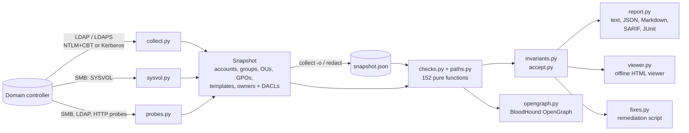

# How it works



Checks never touch the network, which keeps them fast and lets the unit tests run
without a domain controller; the collector itself is tested against a fake LDAP
connection and, through `tests/test_lab.py`, against the live lab DC.

## Tier 0 and the risk score

Template checks fire only for templates published on an enterprise CA that issue without
manager approval or authorized signatures and that broad groups (Domain Users, Domain
Computers, Authenticated Users, Everyone) can enroll in. "Tier 0" means
Domain/Enterprise/Schema Admins, Administrators, the operator groups, domain controllers,
SYSTEM and the built-in Administrator; for the Group Policy local group checks, tier-0
servers are DCs, CA hosts, Entra Connect servers, Exchange servers and computers that are
in a tier-0 group or hold DCSync. Well-known delegations (SELF, Key Admins on
`msDS-KeyCredentialLink`, Cert Publishers and the CA server on PKI objects) are not
reported. Every finding carries its MITRE ATT&CK techniques (`ad-doctor checks -f json`).

The risk score adds 15 per high, 6 per medium and 2 per low finding, capped at 100;
grades run from A (10 or less) to F (above 70). It is meant for tracking one domain over
time, not for comparing domains.

## Performance

`scripts/bench.py` builds a synthetic enterprise domain (an OU tree of 8 regions, 80
sites and 480 departments, nested groups, delegated OU permissions that inherit, default
DACLs on every object, linked and filtered GPOs and templates) and times each stage. On one core of an Intel
Xeon Gold 6138 (2017), Python 3.12:

| Domain | Snapshot | Load | All checks + paths | OpenGraph export | Plan | Peak memory |
|---|---|---|---|---|---|---|
| 10,000 users, 3,300 computers, 19,000 ACEs | 14 MB | 0.4 s | 0.8 s | 0.6 s | 1.9 s | 0.1 GB |
| 100,000 users, 33,000 computers, 127,000 ACEs | 128 MB | 3.9 s | 8.7 s | 6.9 s | 5.6 s | 0.8 GB |
| 250,000 users, 83,000 computers, 308,000 ACEs | 319 MB | 9.2 s | 22.5 s | 18.0 s | 11.4 s | 2.1 GB |

Plan is `cut.plan` on a graph built with provenance (another 0.6 s, 7.0 s and 20.1 s to
build), paths only; the plan stage stays under the peak of the earlier ones. The
generator lists nested Domain Admins members as tier 0, as a collection does, so the
paths, and these rows, differ from earlier versions.

Analysis grows linearly with the size of the domain. Collection time is set by the DC:
the snapshot comes from a few paged LDAP searches, so it scales with the number of objects
and the network round trip, not with the number of checks.

```bash
uv run python scripts/bench.py --users 100000
```

## Development

```bash
uv sync
uv run ruff check . && uv run mypy && uv run pytest
```

See [CONTRIBUTING.md](https://github.com/brkozer/ad-doctor/blob/main/CONTRIBUTING.md) for adding a check and [SECURITY.md](https://github.com/brkozer/ad-doctor/blob/main/SECURITY.md)
for reporting vulnerabilities. Changes are listed in [CHANGELOG.md](https://github.com/brkozer/ad-doctor/blob/main/CHANGELOG.md).

[`lab/`](https://github.com/brkozer/ad-doctor/blob/main/lab) builds a disposable Windows Server 2025 evaluation DC under KVM and seeds
it; see [lab/README.md](https://github.com/brkozer/ad-doctor/blob/main/lab/README.md). With the lab running:

```bash
AD_DOCTOR_LAB_HOST=127.0.0.1 AD_DOCTOR_LAB_PORT=10636 AD_DOCTOR_LAB_SMB_PORT=10445 \
AD_DOCTOR_LAB_PLAIN_PORT=10389 AD_DOCTOR_LAB_HTTP_PORT=10080 \
AD_DOCTOR_LAB_USER='ADLAB\adreader' AD_DOCTOR_PASSWORD=... uv run pytest -m lab

uv run python scripts/demo_svg.py docs/demo.svg   # regenerate the terminal screenshot
```
