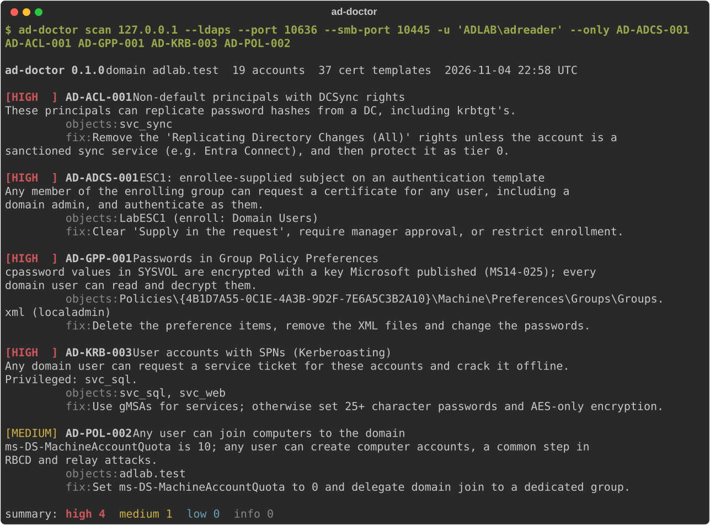

# ad-doctor

Read-only Active Directory security audit that fits in a pipeline.

ad-doctor binds as an ordinary domain user, takes one snapshot of the domain over LDAP
(plus SYSVOL and a few cheap probes of every DC over SMB, LDAP, HTTP and the CA registry)
and runs 152 checks for what attackers look for first: roastable accounts, risky delegation,
exploitable certificate templates and CA settings (ESC1-11 and 13-17), DCSync and other
takeover rights, shadow credentials, BadSuccessor, PrivExchange, exposed Entra Connect sync
accounts, editable GPOs on domain controllers, local admin and remote logon rights handed
out by Group Policy, passwords in Group Policy and scripts, relay-friendly DCs, weak DNS
zones, weak trusts and legacy configuration. It then finds every control path from a
non-admin to tier 0. **It writes nothing to the directory.**

A real scan of the seeded lab domain, taken with an earlier version, so it shows fewer checks
than a scan does today.

- **[Quick start](quickstart.md)**: install and run your first scan.
- **[Check catalog](checks/index.md)**: what each of the 152 checks and 5 invariants looks for and how to fix it.
- **[What-if and plan](whatif.md)**: the cheapest set of changes that closes the paths, tried on the snapshot.
- **[CI integration](ci.md)**: SARIF, JUnit, baselines and accepted risks.
- **[Permissions needed](permissions.md)**: an enabled domain user, nothing more.
- **[Limits](limits.md)**: what it does not see, check by check.

## What sets it apart

- **Attack paths without a graph database.** `AD-PATH-001` builds the control graph from the
  snapshot and reports the shortest path from every non-tier-0 principal to tier 0;
  `ad-doctor blast-radius` answers "what does this account control if it is phished?".
- **A remediation plan with a proof.** [`plan`](whatif.md) finds the cheapest set of removals
  that closes the paths and says when it is a proven minimum; `whatif` shows what given
  removals would close, reroute or leave open, on the snapshot, never on AD.
- **A report you can hand over.** The [HTML viewer](viewer.md) is one offline file with the
  paths drawn step by step, blast radius, a live what-if, the changes since a baseline and
  the trend. It cannot make a request, and it is encrypted when it maps the domain.
- **Honest about what it could not see.** Every check is judged, not applicable, or not
  evaluated with the reason, and one that could not read its data never counts as passed.
- **Plays well with BloodHound.** The [OpenGraph export](bloodhound.md) keeps SIDs, so its
  edges attach to an existing SharpHound graph instead of building a second one. BloodHound
  offers Search and Cypher on it, not Pathfinding.
- **Every DC, not just one.** LDAP signing, SMB signing, the spooler and channel binding are
  [probed](probes.md) on each domain controller, and findings name the ones that drift.
- **Built for CI.** SARIF 2.1.0, JUnit, JSON with stable fingerprints, `--fail-on` and
  `--baseline` so a scheduled job fails only on *new* findings.
- **Policy as code.** An [`invariants.toml`](invariants.md) declares the expected state, and
  [declared tier 0](declared-tier0.md) adds the assets you treat as tier 0.
- **Shareable snapshots.** [`redact`](snapshots.md) pseudonymizes names, hosts and the domain
  SID with a keyed HMAC, so a snapshot can go to a consultant and still produce the same
  findings.
- **Forests too.** A [forest scan](forest.md) reads every domain, one at a time, and never
  reads as complete when a domain is missing.

Tools like PingCastle and Purple Knight cover more ground overall and Locksmith goes deeper
into AD CS; ad-doctor is the scriptable option, and the one that tests itself against a
live DC.
