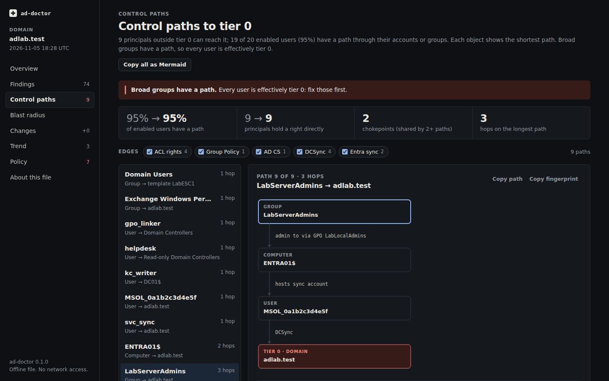
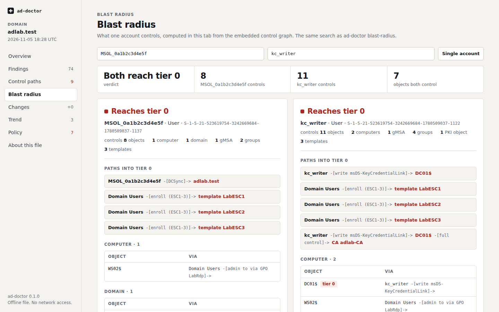
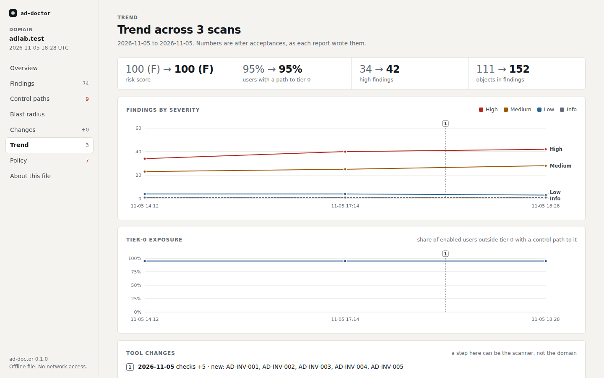
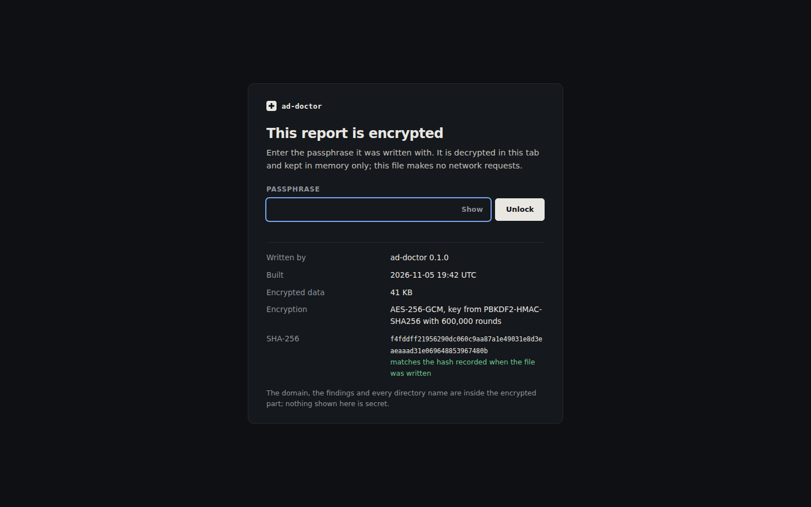

# The HTML viewer

`ad-doctor view` (and `-f html` on `scan` and `analyze`, which use the same builder) writes
one self-contained HTML file. Python computes everything (findings, paths, chokepoints,
the baseline diff, acceptances, invariants, the trend and, for large domains, the blast
radius); the page renders, filters and navigates it, and walks the control graph when one
is embedded. It needs no server and works from a USB stick or an air-gapped laptop.

```bash
ad-doctor view 2026-11.json --baseline 2026-10.json --history reports/ \
  --accept accept.toml --invariants invariants.toml --fixes -o 2026-11.html --open
```

<p align="center"></p>

## Screens

| Screen | What it shows |
|---|---|
| Overview | tier-0 exposure, score and grade (and the baseline's), severity and category, compound findings, top actions, acceptance and invariant tiles, what was not checked |
| Findings | filters (severity, category, ATT&CK, new only) and search, kept in the URL; the evidence, objects with fingerprints, the catalog's explanation, the remediation and, with `--fixes`, the fix-script lines; CSV and JSON export; *Add to acceptance draft* |
| Control paths | each path drawn as a chain, filters by edge kind (membership, ACL rights, ownership, containment, Group Policy, AD CS, DCSync, gMSA, Entra sync, delegation, SID history), a node inspector, the steps the most paths share ("break here first"), copy as Mermaid |
| Blast radius | any account (typeahead over sAMAccountName and SID): whether it reaches tier 0, the paths that get it there, and everything else it controls grouped by kind with the step that reaches each object; two accounts side by side |
| Changes | with `--baseline`, or with a JSON report dropped on the screen: score, exposure, and new, resolved and changed objects (a path that takes another route is *changed*, not new) |
| What-if | with `--whatif plan.json` (the output of `plan -f json` or `whatif -f json` on the same snapshot file): exposure before and after, the steps with their change IDs, the fix lines with `--fixes`, the paths closed, still open or new, the sources no removal can close, and the findings that would clear or appear |
| Trend | with `--history`: severity counts and tier-0 exposure per scan, category scores as a heat map, and markers where the ad-doctor version or the set of checks changed |
| Policy | an acceptance draft builder that downloads `accept-draft.toml`; the acceptance file with active, expiring, expired and stale entries; each invariant section, declared against actual |
| About | what the file contains, the payload's SHA-256 and a check of it, the CSP in force and a self-check that requests are blocked, a print view for an executive PDF |

<p align="center"></p>

### Blast radius and `--graph`

| `--graph` | What the file holds | Blast radius screen |
|---|---|---|
| `full` | the whole control graph as a node table and integer edge arrays, plus every account | any account, searched in the page by a JavaScript port of `paths.reachable` |
| `paths` | no graph; the blast radius of the first 25 principals that hold a right on a control path and of each `--blast-radius-for ACCOUNT`, computed at build time (the first 20 tier-0 paths and up to 50 objects per kind each) | those principals and accounts |
| `none` | neither | an explanation |

The default, `auto`, is `full` up to 50,000 directory objects (accounts, groups, OUs,
GPOs and templates) and `paths` above; a JSON report holds no graph, so a page built from
one has none. The JavaScript search visits nodes in the same order as Python's and finds
the same paths: Node tests compare it, account by account, with `paths.blast_radius` on
the test fixtures, a 3,000-user `bench.py` domain and the lab snapshot.

### Trend and `--history`

`--history DIR` reads every ad-doctor JSON report in `DIR` (`scan -f json` or
`analyze -f json` output; other JSON files such as snapshots are skipped) and adds the
current run. Reports of another domain are refused. Since this version the JSON report
carries `"schema": 2` and `checks`, the IDs of the checks that ran, so the trend can mark
a scan where the check set changed; for older reports only a version change is marked.
Exposure comes from AD-PATH-001; a report without that finding counts as 0%, unless the
check did not run or was accepted.

```bash
ad-doctor analyze snap.json -f json -o reports/$(date +%F).json   # in a scheduled job
ad-doctor view snap.json --history reports/ -o trend.html
```

<p align="center"></p>

### Acceptance drafts and ad-hoc diffs

*Add to acceptance draft* on a finding collects it on the Policy screen, where you pick
the objects (or the whole check), the reason, owner, ticket and expiry, and download
`accept-draft.toml` in the format `--accept` reads. The page never writes anywhere else:
review the draft and merge it into the accept file in your repository. A test runs the
page's TOML writer in Node on hostile strings and parses the result with `accept.py`.

On the Changes screen, drop a JSON report (or pick one) to compare with it right away,
keyed like `ad-doctor diff` by check and object identity. The file is read in the tab and
not kept.

## Encryption

A file that embeds graph data (`--graph full` or `paths`) is encrypted by default, because
it maps who can take over what. `--no-encrypt` writes it in the clear and must be given
explicitly; `--encrypt` encrypts a file without a graph too. `scan -f html` and
`analyze -f html` never embed a graph and are not encrypted.

```bash
export AD_DOCTOR_VIEW_PASSPHRASE='...'      # or answer the prompt (asked twice)
ad-doctor view snap.json -o report.html     # graph embedded, so encrypted
ad-doctor view snap.json --graph none -o summary.html   # no graph, not encrypted
```

- The payload is gzip-compressed and encrypted with AES-256-GCM under a key from
  PBKDF2-HMAC-SHA256 with 600,000 iterations, a random 16-byte salt and a random 12-byte
  nonce. The page decrypts it with WebCrypto.
- The passphrase must have at least 14 characters (and 6 different ones). The prompt
  offers a random seven-word passphrase from a 512-word list (63 bits). In a
  non-interactive run without `AD_DOCTOR_VIEW_PASSPHRASE`, `view` stops and says so.
- Before unlock the page shows only the ad-doctor version, the build time, the
  encryption parameters, and the size and SHA-256 of the ciphertext. The version, build
  time and parameters are GCM additional data: edit one and decryption fails. The size and
  the SHA-256 are measured by the page from the data in the file; if the SHA-256 differs
  from the one recorded at build time, the page refuses to unlock. The domain and every
  name are inside the ciphertext, which the GCM tag authenticates.
- No directory name goes into the URL or the browser history: the blast radius screen
  keeps an index in the address bar, and the findings search stays out of it.
- **Lock** drops the page's references to the decrypted data and reloads it locked.
- `AD_DOCTOR_VIEW_PASSPHRASE` is removed from `view`'s environment once read, so a browser
  started with `--open` does not inherit it.

<p align="center"></p>

## How the file stays safe to open and to send

- **Directory names are treated as hostile.** Any user can create a computer account while
  MachineAccountQuota is above 0, so names reach the page only as text: the script builds
  every element itself, never parses markup, and a test fails the build if it uses
  `innerHTML` or any other HTML sink. The data sits gzip-compressed and base64-encoded in a
  `<script type="application/json">` element, with `<`, `>`, `&`, U+2028 and U+2029
  escaped inside it. A fixture domain whose names are XSS payloads is rendered in pytest
  and in Playwright tests (every screen, the blast radius of every suggested account)
  that check no injected script runs and no request is made.
- **No egress.** The CSP is `default-src 'none'`, with the inlined script and style
  allowed by SHA-256, `connect-src 'none'`, no forms, frames or plugins, and Trusted Types
  enforced where the browser supports them. The page links nowhere; documentation URLs
  are shown as text to copy.
- **Minimum data.** The file holds what the report says plus the paths and what `--graph`,
  `--history` and `--whatif` add, never the raw snapshot. A `--whatif` plan brings change
  labels, path strings and, with `--fixes`, PowerShell lines; encryption follows the graph,
  so pass `--encrypt` for a page with a plan and no graph. A redacted snapshot shows its pseudonyms
  only. Nothing is stored in the browser (no localStorage, IndexedDB or cookies). The file
  is written with mode 0600.
- **What encryption does not cover.** Once unlocked, browser extensions with access to
  file URLs can read the page, and the operating system can page its memory to swap or a
  hibernation file. Open it on a trusted workstation in a browser profile without
  extensions. See [SECURITY.md](https://github.com/brkozer/ad-doctor/blob/main/SECURITY.md).
- **A view, not evidence.** Anyone can edit an HTML file; rebuild it from the snapshot to
  be sure.

## Size and speed

Measured on `scripts/bench.py` domains and the lab, on one core of an Intel Xeon Gold 6138
(2017), on Python 3.12, with the defaults: `--graph auto`, and so encrypted,
since every one of these files embeds graph data. `ad-doctor view` includes loading the
snapshot, running every check, building the graph data and encrypting; peak memory is the
build's. First screen is from opening the same file built with `--no-encrypt` to the
first screen in headless Chromium 156; unlock is from clicking Unlock to the first screen,
most of it the 600,000 PBKDF2 rounds; both are the median of five runs, as is the
JavaScript heap after unlocking and one blast-radius lookup.

| Domain | Graph | HTML file | `ad-doctor view` | Build memory | First screen | Unlock | JS heap |
|---|---|---|---|---|---|---|---|
| lab (49 accounts) | full | 228 KB | 0.8 s | 54 MB | 108 ms | 0.82 s | 3.0 MB |
| 10,000 users | full | 794 KB | 3.3 s | 106 MB | 154 ms | 0.82 s | 7.6 MB |
| 100,000 users | paths | 1.5 MB | 30 s | 0.60 GB | 198 ms | 0.82 s | 7.9 MB |
| 250,000 users | paths | 3.5 MB | 83 s | 1.43 GB | 354 ms | 0.83 s | 14.4 MB |

An account's blast radius on the 10,000-user page, searched in the page and drawn, takes
under 20 ms. Forcing `--graph full` on the 100,000-user domain gives a 6.3 MB file, a
657 ms first screen, a 49 MB heap and 77 ms per account; `auto` switches to `paths` well
before that. Encryption adds under half a second to the build (0.36 s on the lab, 0.3 s
at 10,000 users). Object lists with
thousands of rows are drawn as they scroll into view.

## Paths and chokepoints on the command line

The same path data is available without the page:

```bash
ad-doctor paths 2026-11.json                       # every path, broad groups first
ad-doctor paths 2026-11.json --chokepoints         # steps shared by 2 or more paths
ad-doctor paths 2026-11.json -f mermaid > paths.md
ad-doctor blast-radius 2026-11.json svc_backup     # one account, like the Blast radius screen
```
